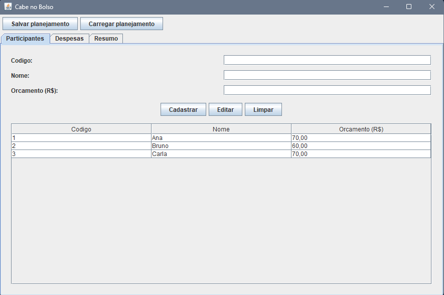
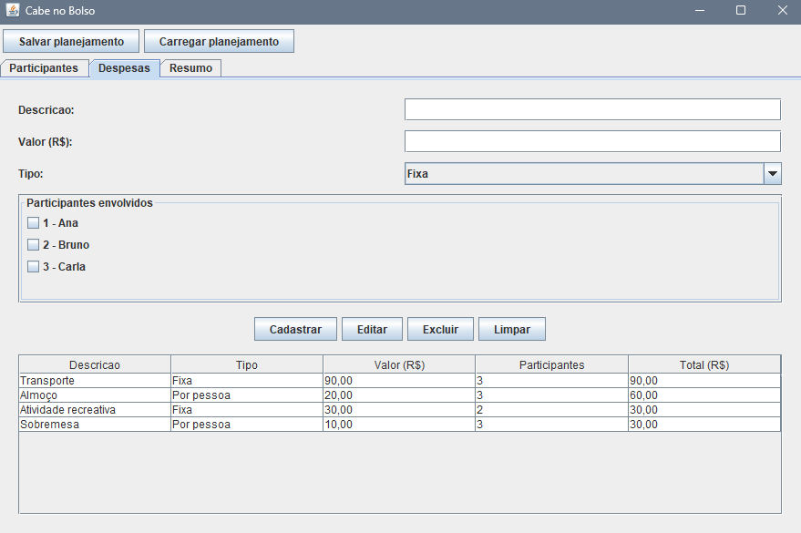
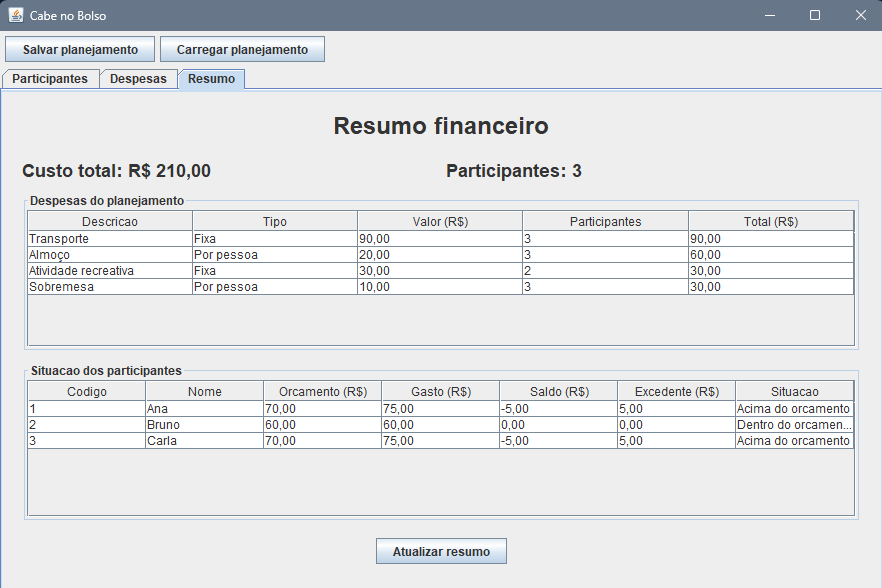
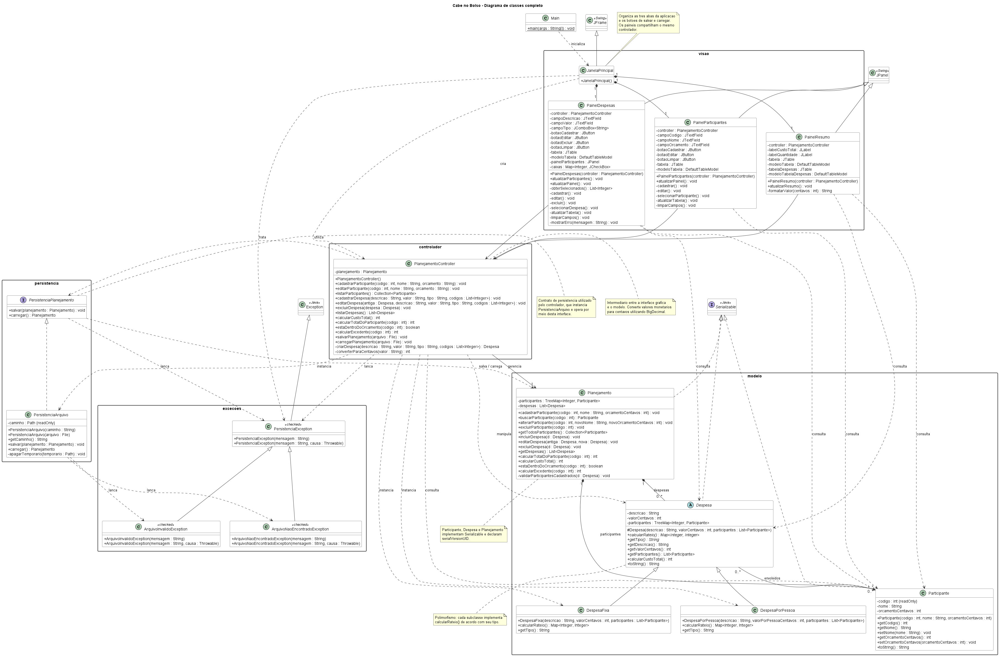
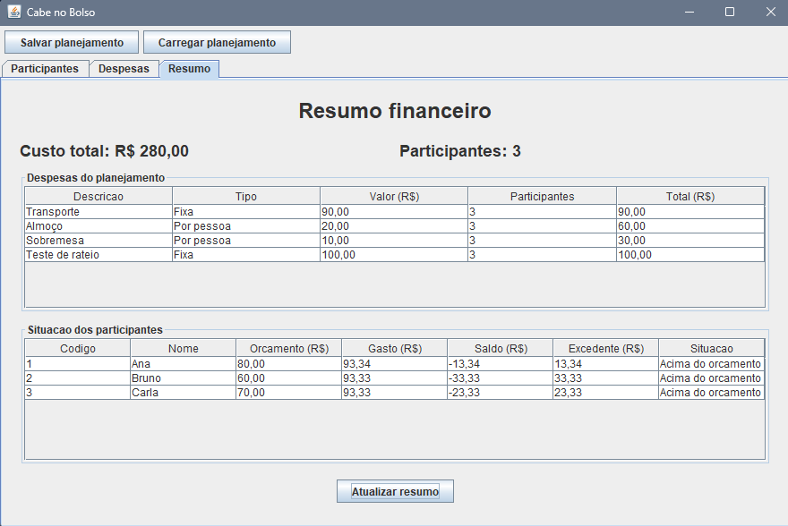
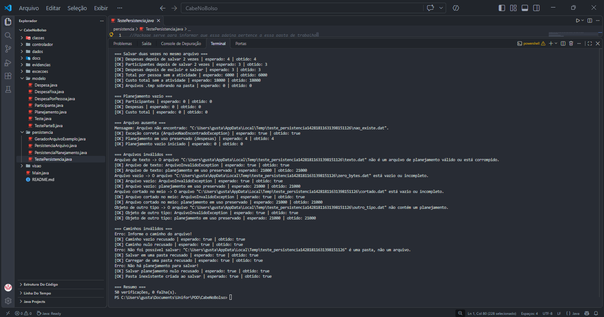
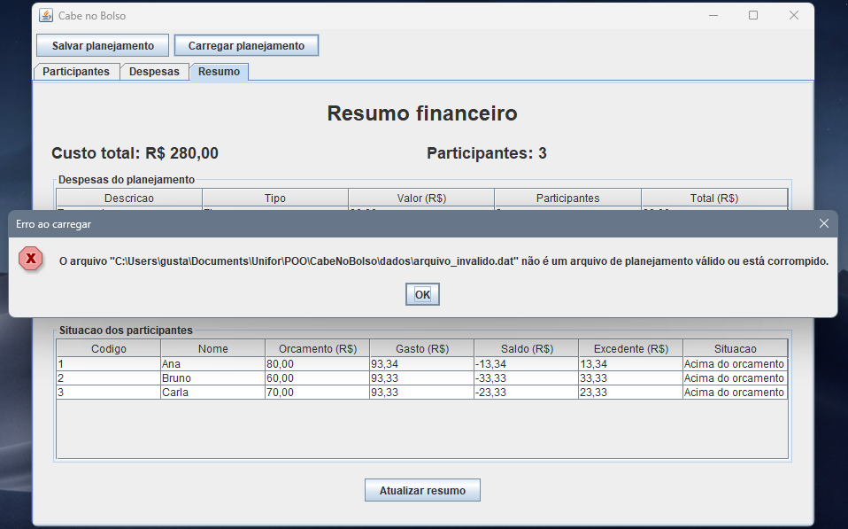

# Cabe no Bolso — Planejador de Despesas Compartilhadas


## Identificação acadêmica

- **Instituição:** Universidade de Fortaleza — Unifor
- **Curso:** Análise e Desenvolvimento de Sistemas
- **Disciplina:** Programação Orientada a Objetos
- **Equipe:** Grupo 12
- **Ano:** 2026

## Sobre o projeto

O **Cabe no Bolso — Planejador de Despesas Compartilhadas** é uma aplicação desktop desenvolvida em Java para a disciplina de Programação Orientada a Objetos do curso de Análise e Desenvolvimento de Sistemas da Universidade de Fortaleza (Unifor).

O projeto tem como objetivo facilitar o planejamento de despesas compartilhadas, permitindo calcular os custos individuais e verificar se os valores respeitam o orçamento de cada participante.

A aplicação possui uma interface gráfica desenvolvida com Java Swing, permitindo gerenciar participantes e despesas, consultar resultados financeiros e realizar o salvamento e a recuperação de planejamentos.

## Integrantes e contribuições

O projeto foi desenvolvido coletivamente pelos integrantes do Grupo 12, com divisão de responsabilidades entre as etapas de modelagem, implementação, interface gráfica, persistência, testes e documentação.

| Integrante | Responsabilidade |
|---|---|
| Carlos Humberto Costa de Oliveira | Modelo — Parte B |
| Cauã Henry Barbosa Moreira | Persistência, tratamento de exceções e diagrama UML |
| Gustavo Felix de Oliveira | Testes, evidências, relatório técnico e README |
| João Bôsco Trindade de Freitas Neto | Modelo — Parte A |
| Luiz Guilherme Clarindo Pinheiro | Interface gráfica Java Swing — Partes A e B |

Todos os integrantes recebem os créditos pelas respectivas contribuições ao desenvolvimento do projeto.

As matrículas acadêmicas foram preservadas no relatório destinado à instituição e não são disponibilizadas neste repositório público.

## Tecnologias utilizadas

- Java 25 LTS
- Java Swing
- Programação Orientada a Objetos (POO)
- Arquitetura MVC (Model-View-Controller)
- Java Collections Framework
- Serialização de objetos
- PlantUML
- Visual Studio Code
- Git e GitHub

## Funcionalidades

### Gerenciamento de participantes

- Cadastro de participantes.
- Identificação por código único.
- Definição de orçamento individual.
- Alteração dos dados cadastrados.
- Validação das informações fornecidas.
- Consulta dos participantes cadastrados.

### Gerenciamento de despesas

- Cadastro de despesas fixas.
- Cadastro de despesas por pessoa.
- Seleção dos participantes envolvidos em cada despesa.
- Edição de despesas.
- Exclusão de despesas.
- Rateio com precisão de centavos.
- Recálculo dos valores individuais.

### Resumo financeiro

- Apresentação do custo total do planejamento.
- Apresentação da quantidade de participantes.
- Consulta das despesas cadastradas.
- Cálculo dos gastos individuais.
- Cálculo do saldo disponível.
- Identificação de valores excedentes.
- Verificação da situação orçamentária de cada participante.

### Persistência de dados

- Salvamento do planejamento em arquivo `.dat`.
- Recuperação de planejamentos anteriormente salvos.
- Serialização e desserialização de objetos.
- Tratamento de arquivos inexistentes.
- Tratamento de arquivos inválidos ou corrompidos.
- Preservação do planejamento em uso diante de falhas de carregamento, conforme os testes realizados.

## Interface gráfica

A interface gráfica foi desenvolvida utilizando Java Swing e está organizada em três abas principais.

### Participantes

Permite cadastrar participantes, definir seus orçamentos e alterar informações anteriormente registradas.



### Despesas

Permite cadastrar, editar e excluir despesas, selecionar os participantes envolvidos e definir o tipo de cobrança.



### Resumo financeiro

Apresenta o custo total do planejamento, as despesas cadastradas e a situação financeira individual dos participantes.



## Conceitos de Programação Orientada a Objetos

Durante o desenvolvimento do projeto, foram utilizados os seguintes conceitos:

- Classes e objetos.
- Atributos e métodos.
- Encapsulamento.
- Abstração.
- Herança.
- Polimorfismo.
- Classes abstratas.
- Interfaces.
- Coleções genéricas.
- Tratamento de exceções.
- Organização e separação de responsabilidades.

A classe abstrata `Despesa` representa as características comuns das despesas, enquanto as classes `DespesaFixa` e `DespesaPorPessoa` representam suas especializações.

A utilização dessas classes permite aplicar diferentes regras de cálculo de acordo com o tipo de despesa, explorando os conceitos de herança e polimorfismo.

## Arquitetura do sistema

O projeto está organizado de acordo com a arquitetura MVC, que separa as responsabilidades da aplicação em três componentes principais:

- **Model (Modelo):** responsável pelas entidades, regras de negócio, validações e cálculos financeiros.
- **View (Visão):** responsável pela interface gráfica e pela interação com o usuário.
- **Controller (Controlador):** responsável pela comunicação entre a interface gráfica e o modelo.

Além desses componentes, o projeto possui estruturas específicas destinadas à persistência de dados, ao tratamento de exceções, à documentação técnica e às evidências dos testes.

## Estrutura do projeto

```text
CabeNoBolso/
├── controlador/
│   └── PlanejamentoController.java
├── dados/
│   ├── arquivo_invalido.dat
│   ├── caso_referencia.dat
│   └── teste_persistencia.dat
├── docs/
│   ├── diagrama_classes.png
│   ├── diagrama_classes.puml
│   ├── diagrama_classes.svg
│   ├── modelagem.md
│   └── TESTES.md
├── evidencias/
├── excecoes/
│   ├── ArquivoInvalidoException.java
│   ├── ArquivoNaoEncontradoException.java
│   └── PersistenciaException.java
├── modelo/
│   ├── Despesa.java
│   ├── DespesaFixa.java
│   ├── DespesaPorPessoa.java
│   ├── Participante.java
│   ├── Planejamento.java
│   ├── Teste.java
│   └── TesteParteB.java
├── persistencia/
│   ├── GeradorArquivoExemplo.java
│   ├── PersistenciaArquivo.java
│   ├── PersistenciaPlanejamento.java
│   └── TestePersistencia.java
├── visao/
│   ├── JanelaPrincipal.java
│   ├── PainelDespesas.java
│   ├── PainelParticipantes.java
│   └── PainelResumo.java
├── .gitattributes
├── .gitignore
├── Main.java
└── README.md
```

### Descrição dos diretórios

| Diretório ou arquivo | Responsabilidade |
|---|---|
| `controlador/` | Controle das operações da aplicação. |
| `dados/` | Arquivos de planejamento e exemplos utilizados nos testes. |
| `docs/` | Documentação técnica e diagramas UML. |
| `evidencias/` | Capturas de tela e resultados textuais dos testes. |
| `excecoes/` | Exceções relacionadas à persistência de dados. |
| `modelo/` | Entidades, regras de negócio e testes do modelo. |
| `persistencia/` | Salvamento, recuperação e testes de persistência. |
| `visao/` | Interface gráfica desenvolvida com Java Swing. |
| `Main.java` | Ponto de entrada da aplicação. |
| `.gitignore` | Configuração dos arquivos ignorados pelo Git. |
| `.gitattributes` | Configuração dos atributos dos arquivos no Git. |

O diretório `classes/` é gerado durante a compilação e não precisa ser incluído no repositório.

## Requisitos para execução

- Java Development Kit (JDK) instalado.
- Terminal PowerShell ou ambiente compatível.
- Ambiente gráfico para execução da interface Java Swing.

O Visual Studio Code ou outra IDE compatível com Java pode ser utilizado para visualizar e editar o código-fonte.

A aplicação foi compilada e executada durante os testes da equipe utilizando Java 25 LTS.

Não é necessária a instalação de bibliotecas externas para executar a aplicação.

## Como executar o projeto

### 1. Obter o código-fonte

Clone o repositório utilizando o Git:

```bash
git clone https://github.com/gustavofelix-dev/CabeNoBolso.git
```

Também é possível baixar o projeto utilizando a opção **Code > Download ZIP** do GitHub.

### 2. Abrir o projeto

Abra a pasta `CabeNoBolso` no Visual Studio Code ou acesse o diretório pelo terminal.

### 3. Verificar a instalação do Java

Execute os seguintes comandos:

```powershell
java -version
javac -version
```

### 4. Compilar os arquivos

No terminal PowerShell, localizado na raiz do projeto, execute:

```powershell
$fontes = Get-ChildItem -Recurse -Filter *.java | ForEach-Object { $_.FullName }
javac -encoding UTF-8 -d classes $fontes
```

### 5. Executar a aplicação

Após a compilação, execute:

```powershell
java -cp classes Main
```

A interface gráfica do Cabe no Bolso será apresentada, permitindo utilizar as funcionalidades do sistema.

### 6. Carregar um planejamento de exemplo

Para consultar o cenário de referência:

1. Abra a aplicação.
2. Clique em **Carregar planejamento**.
3. Acesse a pasta `dados`.
4. Selecione o arquivo `caso_referencia.dat`.
5. Acesse a aba **Resumo**.

## Diagrama de classes UML

O diagrama de classes representa a estrutura do sistema, suas entidades, atributos, métodos e relacionamentos.



Arquivos complementares:

- [Diagrama UML em formato PNG](docs/diagrama_classes.png)
- [Diagrama UML em formato vetorial SVG](docs/diagrama_classes.svg)
- [Código-fonte do diagrama PlantUML](docs/diagrama_classes.puml)
- [Documentação da modelagem e arquitetura](docs/modelagem.md)

Recomenda-se consultar a versão SVG para visualizar os detalhes do diagrama com maior resolução.

## Caso de referência

Para verificar o funcionamento dos cálculos, foi utilizado um cenário fictício com três participantes e quatro despesas compartilhadas.

### Participantes

| Código | Nome | Orçamento |
|---|---|---:|
| 1 | Ana | R$ 70,00 |
| 2 | Bruno | R$ 60,00 |
| 3 | Carla | R$ 70,00 |

### Despesas

| Descrição | Tipo | Valor | Participantes | Total |
|---|---|---:|---|---:|
| Transporte | Fixa | R$ 90,00 | Ana, Bruno e Carla | R$ 90,00 |
| Almoço | Por pessoa | R$ 20,00 | Ana, Bruno e Carla | R$ 60,00 |
| Atividade recreativa | Fixa | R$ 30,00 | Ana e Carla | R$ 30,00 |
| Sobremesa | Por pessoa | R$ 10,00 | Ana, Bruno e Carla | R$ 30,00 |

### Resultado financeiro

| Participante | Orçamento | Gasto | Saldo | Excedente |
|---|---:|---:|---:|---:|
| Ana | R$ 70,00 | R$ 75,00 | -R$ 5,00 | R$ 5,00 |
| Bruno | R$ 60,00 | R$ 60,00 | R$ 0,00 | R$ 0,00 |
| Carla | R$ 70,00 | R$ 75,00 | -R$ 5,00 | R$ 5,00 |
| **Total** | **R$ 200,00** | **R$ 210,00** | **-R$ 10,00** | **R$ 10,00** |

**Custo total do planejamento: R$ 210,00.**

Ana e Carla ultrapassaram seus respectivos orçamentos em R$ 5,00, enquanto Bruno permaneceu dentro do limite estabelecido.

## Testes e validações

Durante o desenvolvimento e a integração da aplicação, foram realizados testes para verificar o funcionamento das regras de negócio, da interface gráfica e da persistência de dados.

As evidências foram registradas em 26 de novembro de 2026.

### Resultados dos testes

| Funcionalidade testada | Resultado | Evidência |
|---|---|---|
| Cadastro de participantes | Aprovado | [Visualizar](evidencias/04-interface-participantes.png) |
| Cadastro de despesas | Aprovado | [Visualizar](evidencias/05-interface-despesas.png) |
| Resumo financeiro | Aprovado | [Visualizar](evidencias/06-resumo-caso-referencia.png) |
| Alteração de orçamento | Aprovado | [Visualizar](evidencias/07-alteracao-orcamento.png) |
| Edição de despesas no modelo | Aprovado | [Visualizar](evidencias/02-resultado-parte-b.txt) |
| Exclusão de despesas | Aprovado | [Visualizar](evidencias/08-exclusao-despesa.png) |
| Rateio com centavos | Aprovado | [Visualizar](evidencias/09-rateio-centavos.png) |
| Rejeição de código duplicado | Aprovado | [Visualizar](evidencias/10-validacao-codigo-duplicado.png) |
| Rejeição de orçamento negativo | Aprovado | [Visualizar](evidencias/11-validacao-orcamento-negativo.png) |
| Rejeição de despesa inválida | Aprovado | [Visualizar](evidencias/12-validacao-despesa-invalida.png) |
| Salvamento do planejamento | Aprovado | [Visualizar](evidencias/13-salvamento-planejamento.png) |
| Recuperação do planejamento pela interface | Aprovado | [Visualizar](evidencias/14-recuperacao-planejamento.png) |
| Recuperação do caso de referência | Aprovado no teste de persistência | [Visualizar](evidencias/03-resultado-persistencia.txt) |
| Rejeição de arquivo inválido | Aprovado | [Visualizar](evidencias/15-arquivo-invalido.png) |
| Rejeição de despesa sem participantes | Aprovado | [Visualizar](evidencias/16-despesa-sem-participantes.png) |
| Tratamento de arquivo inexistente | Aprovado | [Visualizar](evidencias/03-resultado-persistencia.txt) |

### Teste de rateio com centavos

Foi realizado o teste de uma despesa fixa de R$ 100,00 dividida entre três participantes.

| Participante | Valor individual |
|---|---:|
| Ana | R$ 33,34 |
| Bruno | R$ 33,33 |
| Carla | R$ 33,33 |
| **Total** | **R$ 100,00** |

O resultado demonstrou que o sistema distribui corretamente os centavos restantes, preservando o valor total da despesa.



### Testes de persistência

Os testes de persistência verificaram situações como:

- Salvamento e recuperação de planejamentos.
- Recuperação dos participantes e despesas.
- Preservação dos valores financeiros.
- Salvamento repetido sem duplicação dos registros.
- Salvamento de planejamentos vazios.
- Tratamento de arquivos inexistentes.
- Tratamento de arquivos inválidos ou corrompidos.
- Tratamento de caminhos inválidos.
- Preservação do planejamento em uso após falhas de carregamento.

**Resultado registrado:**

| Indicador | Resultado |
|---|---:|
| Verificações realizadas | 50 |
| Falhas identificadas | 0 |



## Como executar os testes

Após realizar a compilação do projeto, execute os comandos correspondentes a cada etapa.

### Validação do modelo — Parte A

```powershell
java -cp classes modelo.Teste
```

- [Evidência da execução](evidencias/01-validacao-modelo-parte-a.png)
- [Resultado textual](evidencias/01-resultado-parte-a.txt)

### Validação do modelo — Parte B

```powershell
java -cp classes modelo.TesteParteB
```

- [Evidência da execução](evidencias/02-validacao-modelo-parte-b.png)
- [Resultado textual](evidencias/02-resultado-parte-b.txt)

### Validação da persistência

```powershell
java -cp classes persistencia.TestePersistencia
```

- [Evidência da execução — Parte 1](evidencias/03-validacao-persistencia-01.png)
- [Evidência da execução — Parte 2](evidencias/03-validacao-persistencia-02.png)
- [Resultado textual completo](evidencias/03-resultado-persistencia.txt)

## Tratamento de erros

A aplicação apresenta mensagens de erro para orientar o usuário quando são informadas entradas inválidas ou quando ocorrem falhas nas operações de persistência.

Entre as situações verificadas estão:

- Código de participante já cadastrado.
- Orçamento negativo.
- Despesa com valor igual ou inferior a zero.
- Despesa sem participantes selecionados.
- Despesa sem descrição.
- Participante não cadastrado.
- Arquivo de planejamento inexistente.
- Arquivo de planejamento inválido ou corrompido.
- Caminho de arquivo inválido.

Essas validações contribuem para a integridade dos dados e para o funcionamento adequado da aplicação.



## Documentação técnica

A documentação complementar do projeto está organizada nos seguintes arquivos e diretórios:

| Documento | Descrição |
|---|---|
| [Modelagem e arquitetura](docs/modelagem.md) | Descrição das classes, arquitetura MVC, conceitos de POO, persistência e exceções. |
| [Documentação de testes](docs/TESTES.md) | Registro dos testes e validações realizados. |
| [Diagrama UML](docs/diagrama_classes.svg) | Representação da estrutura e dos relacionamentos entre as classes. |
| [Evidências](evidencias/) | Capturas de tela e resultados textuais das validações. |
| [Arquivos de exemplo](dados/) | Planejamentos e arquivos utilizados nos testes. |

## Utilização de inteligência artificial

Durante o desenvolvimento do projeto, foram utilizadas ferramentas de inteligência artificial generativa, incluindo ChatGPT e Claude, como recursos auxiliares nas etapas de organização, desenvolvimento, revisão, testes e documentação.

A utilização desses recursos ocorreu no contexto da atividade acadêmica, conforme as orientações da proposta da disciplina.

As responsabilidades individuais são apresentadas na seção de integrantes e contribuições deste documento.

## Considerações finais

O desenvolvimento do Cabe no Bolso possibilitou a aplicação prática dos conceitos estudados na disciplina de Programação Orientada a Objetos.

A construção do sistema envolveu a modelagem de classes, a implementação de regras de negócio, o desenvolvimento de uma interface gráfica, a persistência de dados e a realização de testes.

O projeto também proporcionou uma experiência de trabalho em equipe, divisão de responsabilidades, integração de código e elaboração de documentação técnica.

Como possibilidades de evolução futura, destacam-se:

- Aprimoramento visual da interface gráfica.
- Exportação de relatórios financeiros.
- Simulação de alternativas de despesas.
- Ampliação dos testes automatizados.
- Implementação de novas funcionalidades de planejamento financeiro.

Essas possibilidades representam sugestões de melhorias futuras e não funcionalidades já implementadas.

## Finalidade acadêmica

Projeto desenvolvido para fins acadêmicos na disciplina de Programação Orientada a Objetos do curso de Análise e Desenvolvimento de Sistemas da Universidade de Fortaleza — Unifor.

Os dados financeiros utilizados nos cenários de demonstração são fictícios.

## Créditos

Desenvolvido pelos integrantes do Grupo 12:

- Carlos Humberto Costa de Oliveira
- Cauã Henry Barbosa Moreira
- Gustavo Felix de Oliveira
- João Bôsco Trindade de Freitas Neto
- Luiz Guilherme Clarindo Pinheiro

---

**Cabe no Bolso — Grupo 12**

Universidade de Fortaleza — Unifor

Análise e Desenvolvimento de Sistemas — 2026
