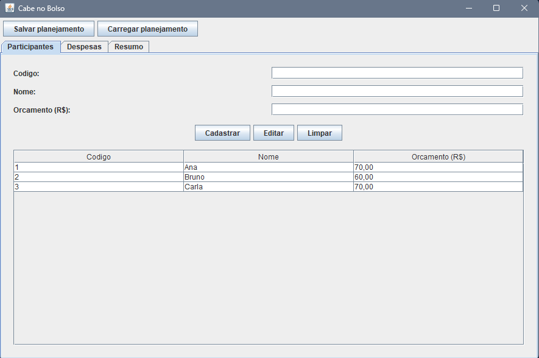
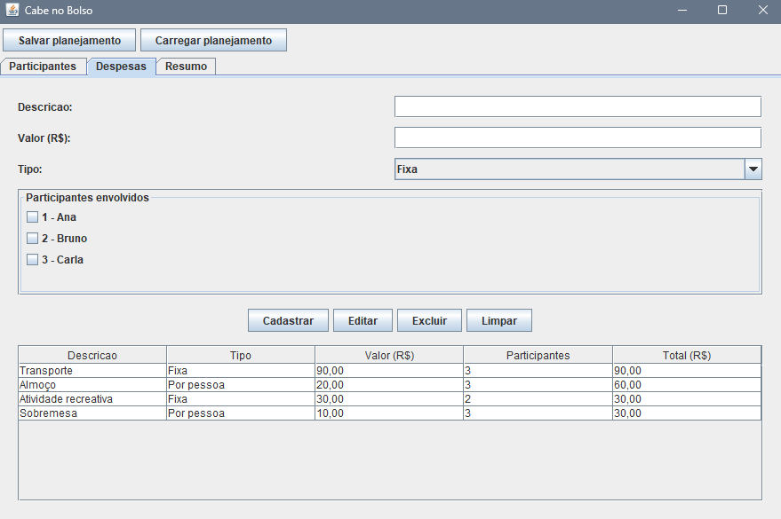
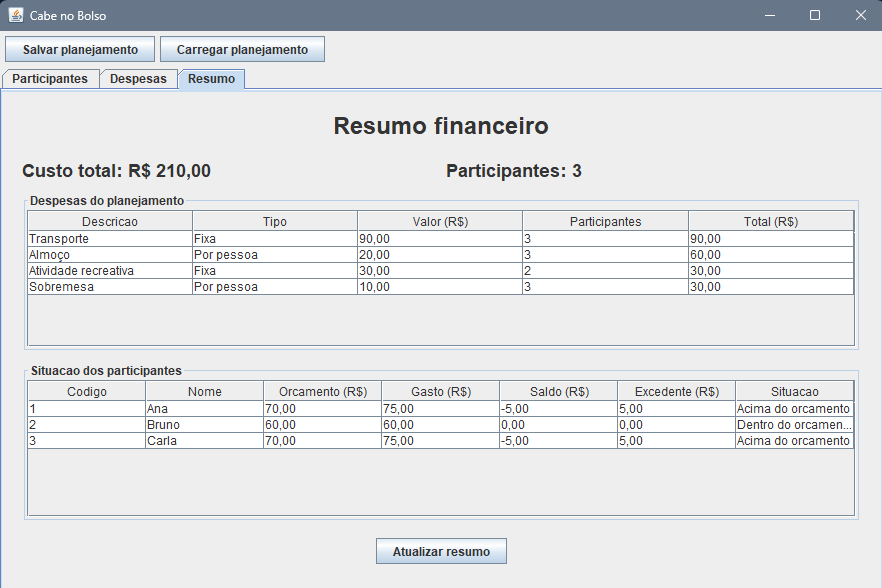
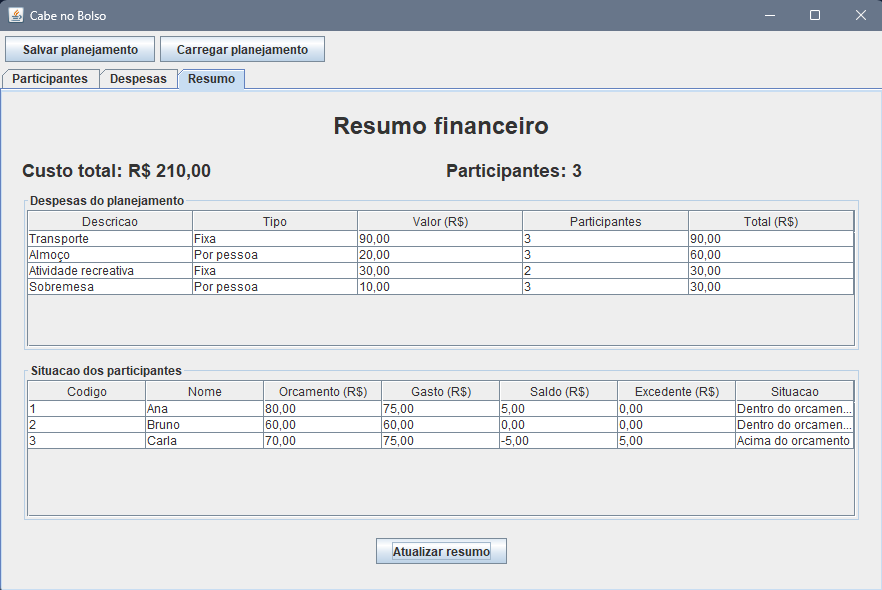
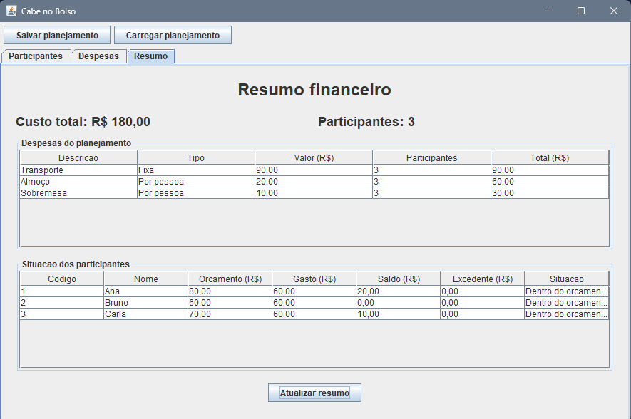
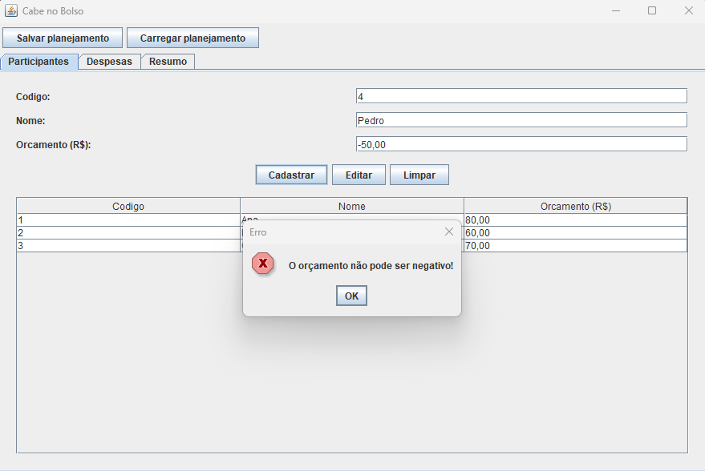
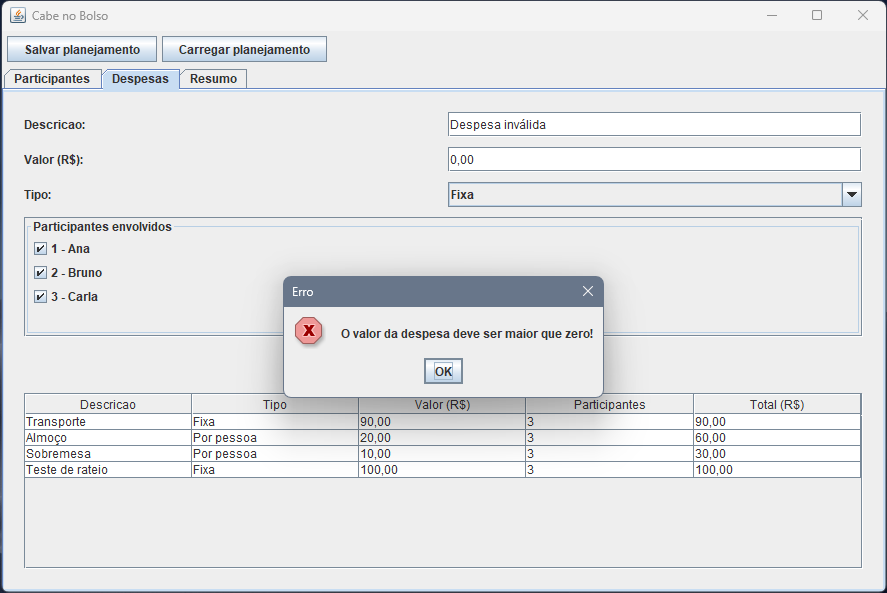
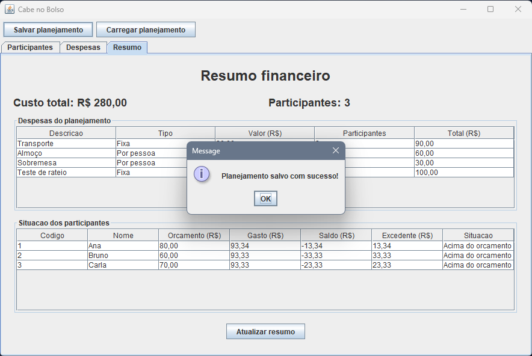
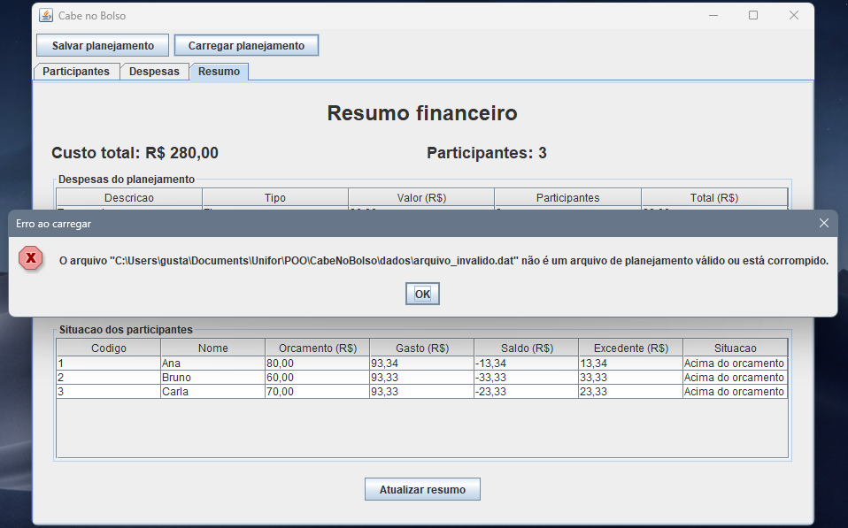
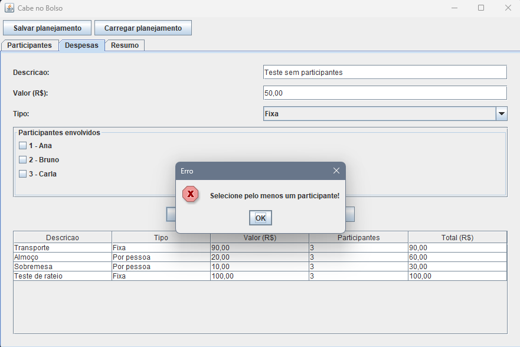

# Documentação de Testes — Cabe no Bolso

## 1. Identificação

- Instituição: Universidade de Fortaleza — Unifor
- Curso: Análise e Desenvolvimento de Sistemas
- Disciplina: Programação Orientada a Objetos
- Equipe: Grupo 12
- Projeto: Cabe no Bolso — Planejador de Despesas Compartilhadas
- Data dos testes: 26/11/2026

## 2. Objetivo

Validar o funcionamento das funcionalidades implementadas no sistema,
verificando as regras de negócio, os cálculos financeiros, a interface
gráfica, a persistência dos dados e o tratamento de entradas inválidas.

## 3. Ambiente de testes

- Sistema operacional: Windows
- Linguagem: Java
- Ambiente de desenvolvimento: Visual Studio Code
- Interface gráfica: Java Swing
- Execução dos testes: terminal PowerShell e interface gráfica

## 4. Testes do modelo

### 4.1. Validação da Parte A

Foram verificadas as operações relacionadas ao cadastro, à consulta,
à edição e à ordenação dos participantes, bem como a rejeição de
códigos duplicados e orçamentos negativos.

Evidências:

- [Captura da execução](../evidencias/01-validacao-modelo-parte-a.png)
- [Resultado textual](../evidencias/01-resultado-parte-a.txt)

### 4.2. Validação da Parte B

Foram verificados os cálculos de despesas fixas e por pessoa,
o rateio entre participantes, a distribuição de centavos,
a edição e a exclusão de despesas e as validações das regras de negócio.

Evidências:

- [Captura da execução](../evidencias/02-validacao-modelo-parte-b.png)
- [Resultado textual](../evidencias/02-resultado-parte-b.txt)

## 5. Testes de persistência

Foram verificadas as operações de salvamento e recuperação dos
planejamentos, incluindo arquivos ausentes, vazios, inválidos
ou corrompidos e caminhos inválidos.

Resultado registrado: 50 verificações e 0 falhas.

Evidências:

- [Execução dos testes — Parte 1](../evidencias/03-validacao-persistencia-01.png)
- [Execução dos testes — Parte 2](../evidencias/03-validacao-persistencia-02.png)
- [Resultado textual completo](../evidencias/03-resultado-persistencia.txt)

## 6. Testes da interface gráfica

### 6.1. Cadastro de participantes

Verificação da apresentação dos participantes cadastrados e
dos respectivos orçamentos.

### 6.2. Cadastro de despesas

Verificação da apresentação das despesas fixas e por pessoa,
dos participantes envolvidos e dos valores totais.

### 6.3. Caso de referência

O planejamento apresentou um custo total de R$ 210,00,
distribuído entre três participantes.

| Participante | Orçamento | Gasto | Saldo | Excedente |
|---|---:|---:|---:|---:|
| Ana | R$ 70,00 | R$ 75,00 | -R$ 5,00 | R$ 5,00 |
| Bruno | R$ 60,00 | R$ 60,00 | R$ 0,00 | R$ 0,00 |
| Carla | R$ 70,00 | R$ 75,00 | -R$ 5,00 | R$ 5,00 |

Resultado: conforme esperado.

### 6.4. Alteração de orçamento

O orçamento de Ana foi alterado de R$ 70,00 para R$ 80,00.
Seu gasto permaneceu em R$ 75,00, resultando em saldo positivo
de R$ 5,00 e excedente igual a zero.

Resultado: conforme esperado.

### 6.5. Exclusão de despesa

Após a exclusão da atividade recreativa de R$ 30,00,
o custo total passou de R$ 210,00 para R$ 180,00.
Cada participante passou a ter um gasto de R$ 60,00.

Resultado: conforme esperado.

### 6.6. Rateio de centavos

Foi adicionada uma despesa fixa de R$ 100,00,
compartilhada entre três participantes.

A distribuição da nova despesa foi:

- Ana: R$ 33,34.
- Bruno: R$ 33,33.
- Carla: R$ 33,33.

A soma das parcelas correspondeu exatamente a R$ 100,00,
sem perda de centavos. O custo total do planejamento
passou para R$ 280,00.

Resultado: conforme esperado.

### 6.7. Código duplicado

Foi realizada uma tentativa de cadastrar um participante
utilizando um código já existente.

O sistema rejeitou a operação e apresentou a mensagem:

"Código já cadastrado!"

Resultado: conforme esperado.

### 6.8. Orçamento negativo

Foi realizada uma tentativa de cadastrar um participante
com orçamento de -R$ 50,00.

O sistema rejeitou a operação e apresentou a mensagem:

"O orçamento não pode ser negativo!"

Resultado: conforme esperado.

### 6.9. Despesa inválida

Foi realizada uma tentativa de cadastrar uma despesa
com valor igual a zero.

O sistema rejeitou a operação e apresentou a mensagem:

"O valor da despesa deve ser maior que zero!"

Resultado: conforme esperado.

### 6.10. Salvamento do planejamento

Foi executada a funcionalidade de salvamento do planejamento
em arquivo com extensão .dat.

O sistema apresentou a mensagem:

"Planejamento salvo com sucesso!"

Resultado: conforme esperado.

### 6.11. Recuperação do planejamento

O planejamento anteriormente salvo foi carregado,
apresentando três participantes, quatro despesas
e custo total de R$ 280,00.

Resultado: conforme esperado.

### 6.12. Arquivo inválido

Foi realizada uma tentativa de carregar um arquivo
que não continha um planejamento válido.

O sistema apresentou uma mensagem de erro e manteve
os dados do planejamento em uso.

Resultado: conforme esperado.

### 6.13. Despesa sem participantes

Foi realizada uma tentativa de cadastrar uma despesa
de R$ 50,00 sem selecionar participantes.

O sistema rejeitou a operação e apresentou a mensagem:

"Selecione pelo menos um participante!"

Resultado: conforme esperado.

## 7. Resumo dos resultados

| Funcionalidade | Resultado |
|---|---|
| Validações do modelo — Parte A | Satisfatório |
| Validações do modelo — Parte B | Satisfatório |
| Persistência de dados | 50 verificações, 0 falhas |
| Interface de participantes | Satisfatório |
| Interface de despesas | Satisfatório |
| Cálculos financeiros | Satisfatório |
| Alteração de orçamento | Satisfatório |
| Exclusão de despesas | Satisfatório |
| Rateio de centavos | Satisfatório |
| Validação de código duplicado | Satisfatório |
| Validação de orçamento negativo | Satisfatório |
| Validação de despesa inválida | Satisfatório |
| Salvamento do planejamento | Satisfatório |
| Recuperação do planejamento | Satisfatório |
| Tratamento de arquivo inválido | Satisfatório |
| Validação de despesa sem participantes | Satisfatório |

## 8. Conclusão

Os testes realizados apresentaram resultados compatíveis com
os comportamentos esperados nos cenários avaliados.

As evidências demonstram o funcionamento das regras de negócio,
dos cálculos financeiros, da interface gráfica, da persistência
dos dados e do tratamento de entradas inválidas.

Os resultados obtidos indicam que o sistema Cabe no Bolso
apresenta funcionamento satisfatório nos cenários testados,
atendendo às funcionalidades verificadas durante a validação.
