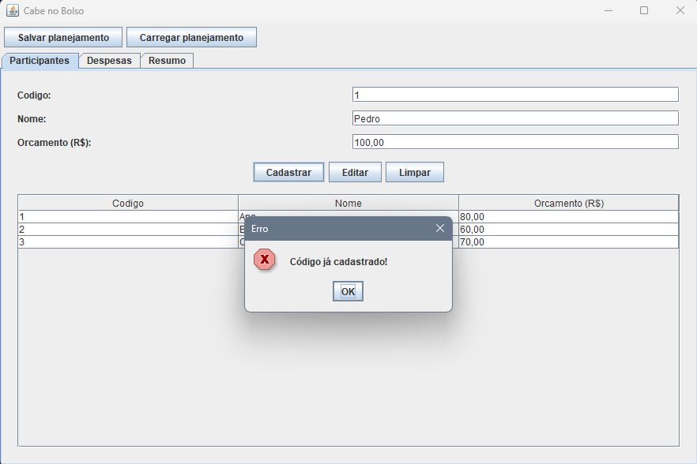
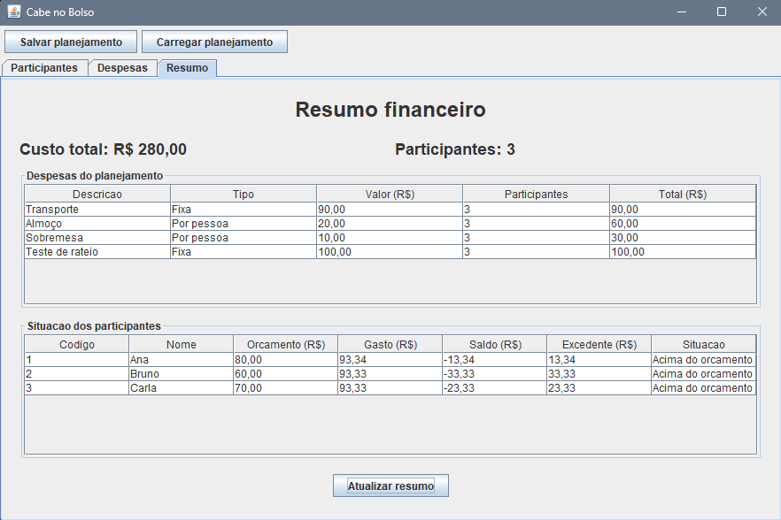
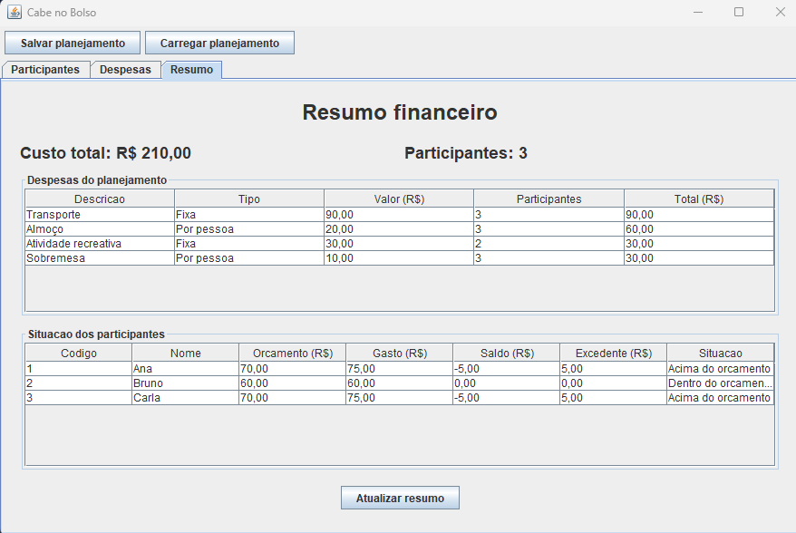
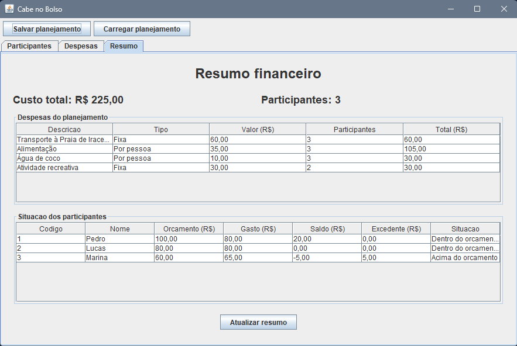

# Documentação de Testes — Cabe no Bolso

## 1. Identificação

- **Instituição:** Universidade de Fortaleza — Unifor
- **Curso:** Análise e Desenvolvimento de Sistemas
- **Disciplina:** Programação Orientada a Objetos
- **Equipe:** Grupo 12
- **Projeto:** Cabe no Bolso — Planejador de Despesas Compartilhadas
- **Data dos testes:** 26/11/2026

## 2. Objetivo

Validar o funcionamento das funcionalidades implementadas no sistema, verificando as regras de negócio, os cálculos financeiros, a interface gráfica, a persistência dos dados e o tratamento de entradas inválidas.

As validações contemplam o caso de referência apresentado na proposta da atividade e um cenário próprio da equipe, relacionado a um passeio fictício à Praia de Iracema, em Fortaleza.

Os dados utilizados nos cenários são fictícios, enquanto os resultados e as evidências correspondem às execuções realizadas durante os testes.

## 3. Ambiente de testes

- **Sistema operacional:** Windows
- **Linguagem:** Java
- **Versão do Java:** 25 LTS
- **Ambiente de desenvolvimento:** Visual Studio Code
- **Interface gráfica:** Java Swing
- **Arquitetura:** MVC (Model-View-Controller)
- **Execução dos testes:** terminal PowerShell e interface gráfica

### 3.1. Compilação do projeto

No terminal PowerShell, localizado na raiz do projeto:

```powershell
$fontes = Get-ChildItem -Recurse -Filter *.java | ForEach-Object { $_.FullName }
javac -encoding UTF-8 -d classes $fontes
```

### 3.2. Execução da aplicação

```powershell
java -cp classes Main
```

## 4. Testes do modelo

### 4.1. Validação da Parte A

Foram verificadas as operações relacionadas ao cadastro, à consulta, à edição e à ordenação dos participantes, bem como a rejeição de códigos duplicados e orçamentos negativos.

| Operação | Resultado esperado | Resultado obtido |
|---|---|---|
| Cadastro de participantes | Registro dos participantes | Conforme esperado |
| Cadastro fora da ordem numérica | Ordenação crescente por código | Conforme esperado |
| Código duplicado | Rejeição da operação | Conforme esperado |
| Orçamento negativo | Rejeição da operação | Conforme esperado |
| Alteração de nome e orçamento | Atualização dos dados | Conforme esperado |

**Resultado:** satisfatório.

Comando para reprodução:

```powershell
java -cp classes modelo.Teste
```

Evidências:

- [Captura da execução](../evidencias/01-validacao-modelo-parte-a.png)
- [Resultado textual](../evidencias/01-resultado-parte-a.txt)

### 4.2. Validação da Parte B

Foram verificados os cálculos de despesas fixas e por pessoa, o rateio entre participantes, a distribuição de centavos, a edição e a exclusão de despesas e as validações das regras de negócio.

| Operação | Resultado esperado | Resultado obtido |
|---|---|---|
| Despesa fixa | Divisão do valor entre os participantes envolvidos | Conforme esperado |
| Despesa por pessoa | Aplicação do valor individual aos participantes envolvidos | Conforme esperado |
| Rateio seletivo | Cobrança apenas dos participantes envolvidos | Conforme esperado |
| Rateio com centavos | Preservação do valor total da despesa | Conforme esperado |
| Edição de despesa | Recálculo dos valores financeiros | Conforme esperado |
| Exclusão de despesa | Atualização dos gastos e do custo total | Conforme esperado |

#### Validação da edição de despesas

No teste da Parte B, foram verificadas alterações na composição dos participantes de uma despesa e no tipo de cobrança.

A atividade recreativa de R$ 30,00 passou a incluir os três participantes, resultando em um rateio de R$ 10,00 para cada um.

Também foi realizada a alteração do almoço, originalmente cadastrado como despesa por pessoa de R$ 20,00, para uma despesa fixa de R$ 60,00 compartilhada entre os três participantes.

O custo total permaneceu em R$ 210,00, demonstrando a consistência dos cálculos após as alterações.

**Resultado:** satisfatório.

Comando para reprodução:

```powershell
java -cp classes modelo.TesteParteB
```

Evidências:

- [Captura da execução](../evidencias/02-validacao-modelo-parte-b.png)
- [Resultado textual](../evidencias/02-resultado-parte-b.txt)

## 5. Testes de persistência

Foram verificadas as operações de salvamento e recuperação dos planejamentos, incluindo arquivos ausentes, vazios, inválidos ou corrompidos e caminhos inválidos.

As verificações contemplaram:

- Salvamento de planejamentos.
- Recuperação de planejamentos.
- Preservação dos participantes cadastrados.
- Preservação das despesas cadastradas.
- Preservação dos valores financeiros.
- Preservação dos vínculos entre participantes e despesas.
- Salvamento repetido sem duplicação de registros.
- Salvamento de planejamentos vazios.
- Tratamento de arquivos inexistentes.
- Tratamento de arquivos inválidos ou corrompidos.
- Tratamento de caminhos inválidos.
- Preservação do planejamento em uso após falhas de carregamento.

### 5.1. Resultado dos testes de persistência

| Indicador | Resultado |
|---|---:|
| Verificações realizadas | 50 |
| Falhas identificadas | 0 |

**Resultado:** satisfatório.

Comando para reprodução:

```powershell
java -cp classes persistencia.TestePersistencia
```

Evidências:

- [Execução dos testes — Parte 1](../evidencias/03-validacao-persistencia-01.png)
- [Execução dos testes — Parte 2](../evidencias/03-validacao-persistencia-02.png)
- [Resultado textual completo](../evidencias/03-resultado-persistencia.txt)

## 6. Testes da interface gráfica

### 6.1. Cadastro de participantes

**Objetivo:** verificar a apresentação dos participantes cadastrados e dos respectivos orçamentos.

Foram cadastrados os participantes utilizados no caso de referência da atividade.

| Código | Participante | Orçamento |
|---|---|---:|
| 1 | Ana | R$ 70,00 |
| 2 | Bruno | R$ 60,00 |
| 3 | Carla | R$ 70,00 |

**Resultado esperado:** apresentação dos participantes e de seus respectivos orçamentos.

**Resultado obtido:** participantes apresentados corretamente.

**Resultado:** conforme esperado.


### 6.2. Cadastro de despesas

**Objetivo:** verificar a apresentação das despesas fixas e por pessoa, dos participantes envolvidos e dos valores totais.

| Descrição | Tipo | Valor | Participantes | Total |
|---|---|---:|---|---:|
| Transporte | Fixa | R$ 90,00 | Ana, Bruno e Carla | R$ 90,00 |
| Almoço | Por pessoa | R$ 20,00 | Ana, Bruno e Carla | R$ 60,00 |
| Atividade recreativa | Fixa | R$ 30,00 | Ana e Carla | R$ 30,00 |
| Sobremesa | Por pessoa | R$ 10,00 | Ana, Bruno e Carla | R$ 30,00 |

**Resultado esperado:** cadastro das quatro despesas, respeitando os tipos de cobrança e os participantes envolvidos.

**Resultado obtido:** despesas apresentadas corretamente.

**Resultado:** conforme esperado.


### 6.3. Caso de referência

**Objetivo:** verificar os resultados financeiros do caso de referência apresentado na proposta da atividade.

O planejamento apresentou um custo total de R$ 210,00, distribuído entre três participantes.

| Participante | Orçamento | Gasto | Saldo | Excedente |
|---|---:|---:|---:|---:|
| Ana | R$ 70,00 | R$ 75,00 | -R$ 5,00 | R$ 5,00 |
| Bruno | R$ 60,00 | R$ 60,00 | R$ 0,00 | R$ 0,00 |
| Carla | R$ 70,00 | R$ 75,00 | -R$ 5,00 | R$ 5,00 |
| **Total** | **R$ 200,00** | **R$ 210,00** | **-R$ 10,00** | **R$ 10,00** |

| Verificação | Esperado | Obtido |
|---|---:|---:|
| Participantes | 3 | 3 |
| Despesas | 4 | 4 |
| Custo total | R$ 210,00 | R$ 210,00 |
| Gasto de Ana | R$ 75,00 | R$ 75,00 |
| Gasto de Bruno | R$ 60,00 | R$ 60,00 |
| Gasto de Carla | R$ 75,00 | R$ 75,00 |

**Resultado:** conforme esperado.


Arquivo de exemplo: [caso_referencia.dat](../dados/caso_referencia.dat).

### 6.4. Alteração de orçamento

**Objetivo:** verificar a atualização da situação financeira após a alteração do orçamento de um participante.

O orçamento de Ana foi alterado de R$ 70,00 para R$ 80,00.

Seu gasto permaneceu em R$ 75,00, resultando em saldo positivo de R$ 5,00 e excedente igual a zero.

| Indicador | Antes | Depois |
|---|---:|---:|
| Orçamento de Ana | R$ 70,00 | R$ 80,00 |
| Gasto de Ana | R$ 75,00 | R$ 75,00 |
| Saldo de Ana | -R$ 5,00 | R$ 5,00 |
| Excedente de Ana | R$ 5,00 | R$ 0,00 |
| Custo total do planejamento | R$ 210,00 | R$ 210,00 |

**Resultado esperado:** atualização do saldo e do excedente sem alteração do custo total.

**Resultado obtido:** atualização correta dos indicadores financeiros.

**Resultado:** conforme esperado.


### 6.5. Exclusão de despesa

**Objetivo:** verificar o recálculo dos gastos individuais e do custo total após a exclusão de uma despesa.

Após a exclusão da atividade recreativa de R$ 30,00, o custo total passou de R$ 210,00 para R$ 180,00.

Cada participante passou a ter um gasto de R$ 60,00.

| Indicador | Antes | Depois |
|---|---:|---:|
| Quantidade de despesas | 4 | 3 |
| Custo total | R$ 210,00 | R$ 180,00 |
| Gasto de Ana | R$ 75,00 | R$ 60,00 |
| Gasto de Bruno | R$ 60,00 | R$ 60,00 |
| Gasto de Carla | R$ 75,00 | R$ 60,00 |

**Resultado:** conforme esperado.


### 6.6. Rateio de centavos

**Objetivo:** verificar a distribuição de centavos restantes em uma despesa fixa cujo valor não pode ser dividido igualmente entre todos os participantes.

Foi adicionada uma despesa fixa de R$ 100,00, compartilhada entre três participantes.

A distribuição da nova despesa foi:

| Participante | Parcela esperada | Parcela obtida |
|---|---:|---:|
| Ana | R$ 33,34 | R$ 33,34 |
| Bruno | R$ 33,33 | R$ 33,33 |
| Carla | R$ 33,33 | R$ 33,33 |
| **Total** | **R$ 100,00** | **R$ 100,00** |

A soma das parcelas correspondeu exatamente a R$ 100,00, sem perda de centavos.

Como o planejamento já apresentava um custo total de R$ 180,00, a inclusão da nova despesa resultou em um custo total de R$ 280,00.

| Participante | Gasto anterior | Rateio adicional | Gasto final |
|---|---:|---:|---:|
| Ana | R$ 60,00 | R$ 33,34 | R$ 93,34 |
| Bruno | R$ 60,00 | R$ 33,33 | R$ 93,33 |
| Carla | R$ 60,00 | R$ 33,33 | R$ 93,33 |
| **Total** | **R$ 180,00** | **R$ 100,00** | **R$ 280,00** |

**Resultado:** conforme esperado.


### 6.7. Código duplicado

**Objetivo:** verificar a rejeição de códigos de participantes já cadastrados.

Foi realizada uma tentativa de cadastrar um participante utilizando um código já existente.

O sistema rejeitou a operação e apresentou a mensagem:

> Código já cadastrado!

**Resultado esperado:** impedir a duplicação do código.

**Resultado obtido:** operação rejeitada.

**Resultado:** conforme esperado.



### 6.8. Orçamento negativo

**Objetivo:** verificar a rejeição de orçamentos individuais negativos.

Foi realizada uma tentativa de cadastrar um participante com orçamento de -R$ 50,00.

O sistema rejeitou a operação e apresentou a mensagem:

> O orçamento não pode ser negativo!

**Resultado esperado:** impedir o cadastro com orçamento negativo.

**Resultado obtido:** operação rejeitada.

**Resultado:** conforme esperado.


### 6.9. Despesa inválida

**Objetivo:** verificar a rejeição de despesas com valor igual a zero.

Foi realizada uma tentativa de cadastrar uma despesa com valor igual a zero.

O sistema rejeitou a operação e apresentou a mensagem:

> O valor da despesa deve ser maior que zero!

**Resultado esperado:** impedir o cadastro da despesa inválida.

**Resultado obtido:** operação rejeitada.

**Resultado:** conforme esperado.


### 6.10. Salvamento do planejamento

**Objetivo:** verificar o salvamento do planejamento em arquivo.

Foi executada a funcionalidade de salvamento do planejamento em arquivo com extensão `.dat`.

O sistema apresentou a mensagem:

> Planejamento salvo com sucesso!

**Resultado esperado:** armazenamento do planejamento e confirmação do salvamento.

**Resultado obtido:** salvamento confirmado pela aplicação.

**Resultado:** conforme esperado.


### 6.11. Recuperação do planejamento

**Objetivo:** verificar a recuperação do planejamento utilizado no teste de rateio com centavos.

O planejamento anteriormente salvo foi carregado, apresentando três participantes, quatro despesas e custo total de R$ 280,00.

| Verificação | Esperado | Obtido |
|---|---:|---:|
| Participantes | 3 | 3 |
| Despesas | 4 | 4 |
| Custo total | R$ 280,00 | R$ 280,00 |
| Gasto de Ana | R$ 93,34 | R$ 93,34 |
| Gasto de Bruno | R$ 93,33 | R$ 93,33 |
| Gasto de Carla | R$ 93,33 | R$ 93,33 |

Este planejamento corresponde ao cenário modificado durante o teste de rateio com centavos, não ao caso de referência original de R$ 210,00.

**Resultado:** conforme esperado.



### 6.12. Arquivo inválido

**Objetivo:** verificar o tratamento de arquivos que não contêm um planejamento válido.

Foi realizada uma tentativa de carregar um arquivo que não continha um planejamento válido.

O sistema apresentou uma mensagem de erro e manteve os dados do planejamento em uso.

**Resultado esperado:** rejeição do arquivo inválido e preservação dos dados atuais.

**Resultado obtido:** arquivo rejeitado e planejamento preservado.

**Resultado:** conforme esperado.


### 6.13. Despesa sem participantes

**Objetivo:** verificar a rejeição de despesas sem participantes envolvidos.

Foi realizada uma tentativa de cadastrar uma despesa de R$ 50,00 sem selecionar participantes.

O sistema rejeitou a operação e apresentou a mensagem:

> Selecione pelo menos um participante!

**Resultado esperado:** impedir o cadastro da despesa sem participantes.

**Resultado obtido:** operação rejeitada.

**Resultado:** conforme esperado.


### 6.14. Recuperação do caso de referência após reinício

**Objetivo:** verificar se o planejamento original é preservado após o encerramento completo e a reinicialização da aplicação.

#### Procedimento realizado

1. Carregamento do caso de referência original.
2. Conferência do custo total de R$ 210,00.
3. Salvamento no arquivo `dados/referencia_validada.dat`.
4. Encerramento completo da aplicação.
5. Reinicialização da aplicação.
6. Carregamento do arquivo anteriormente salvo.
7. Conferência dos participantes, das despesas e do resumo financeiro.

#### Comparação dos resultados

| Verificação | Esperado | Obtido |
|---|---:|---:|
| Quantidade de participantes | 3 | 3 |
| Quantidade de despesas | 4 | 4 |
| Custo total | R$ 210,00 | R$ 210,00 |
| Orçamento de Ana | R$ 70,00 | R$ 70,00 |
| Orçamento de Bruno | R$ 60,00 | R$ 60,00 |
| Orçamento de Carla | R$ 70,00 | R$ 70,00 |
| Gasto de Ana | R$ 75,00 | R$ 75,00 |
| Gasto de Bruno | R$ 60,00 | R$ 60,00 |
| Gasto de Carla | R$ 75,00 | R$ 75,00 |
| Saldo de Ana | -R$ 5,00 | -R$ 5,00 |
| Saldo de Bruno | R$ 0,00 | R$ 0,00 |
| Saldo de Carla | -R$ 5,00 | -R$ 5,00 |
| Excedente de Ana | R$ 5,00 | R$ 5,00 |
| Excedente de Bruno | R$ 0,00 | R$ 0,00 |
| Excedente de Carla | R$ 5,00 | R$ 5,00 |

Os participantes, as despesas e os respectivos valores financeiros foram recuperados corretamente após o reinício da aplicação.

**Resultado:** conforme esperado.



Arquivo utilizado: [referencia_validada.dat](../dados/referencia_validada.dat).

### 6.15. Cenário próprio — Praia de Iracema

**Objetivo:** validar as regras de negócio em um cenário diferente do caso de referência, verificando despesas fixas, despesas por pessoa, rateio seletivo e situações orçamentárias distintas.

#### Contextualização

Foi elaborado um cenário fictício de um passeio de três estudantes à Praia de Iracema, em Fortaleza, Ceará.

O planejamento contempla despesas de transporte, alimentação, água de coco e atividade recreativa.

#### Participantes

| Código | Participante | Orçamento |
|---|---|---:|
| 1 | Pedro | R$ 100,00 |
| 2 | Lucas | R$ 80,00 |
| 3 | Marina | R$ 60,00 |
| | **Total** | **R$ 240,00** |

#### Despesas

| Descrição | Tipo | Valor | Participantes | Total |
|---|---|---:|---|---:|
| Transporte à Praia de Iracema | Fixa | R$ 60,00 | Pedro, Lucas e Marina | R$ 60,00 |
| Alimentação | Por pessoa | R$ 35,00 | Pedro, Lucas e Marina | R$ 105,00 |
| Água de coco | Por pessoa | R$ 10,00 | Pedro, Lucas e Marina | R$ 30,00 |
| Atividade recreativa | Fixa | R$ 30,00 | Pedro e Lucas | R$ 30,00 |
| | | | **Total** | **R$ 225,00** |

#### Cálculo esperado do rateio

| Despesa | Pedro | Lucas | Marina | Total |
|---|---:|---:|---:|---:|
| Transporte | R$ 20,00 | R$ 20,00 | R$ 20,00 | R$ 60,00 |
| Alimentação | R$ 35,00 | R$ 35,00 | R$ 35,00 | R$ 105,00 |
| Água de coco | R$ 10,00 | R$ 10,00 | R$ 10,00 | R$ 30,00 |
| Atividade recreativa | R$ 15,00 | R$ 15,00 | R$ 0,00 | R$ 30,00 |
| **Total** | **R$ 80,00** | **R$ 80,00** | **R$ 65,00** | **R$ 225,00** |

#### Resultado financeiro

| Participante | Orçamento | Gasto | Saldo | Excedente |
|---|---:|---:|---:|---:|
| Pedro | R$ 100,00 | R$ 80,00 | R$ 20,00 | R$ 0,00 |
| Lucas | R$ 80,00 | R$ 80,00 | R$ 0,00 | R$ 0,00 |
| Marina | R$ 60,00 | R$ 65,00 | -R$ 5,00 | R$ 5,00 |
| **Total** | **R$ 240,00** | **R$ 225,00** | **R$ 15,00** | **R$ 5,00** |

#### Comparação dos resultados

| Verificação | Esperado | Obtido |
|---|---:|---:|
| Quantidade de participantes | 3 | 3 |
| Quantidade de despesas | 4 | 4 |
| Custo total | R$ 225,00 | R$ 225,00 |
| Gasto de Pedro | R$ 80,00 | R$ 80,00 |
| Gasto de Lucas | R$ 80,00 | R$ 80,00 |
| Gasto de Marina | R$ 65,00 | R$ 65,00 |
| Saldo de Pedro | R$ 20,00 | R$ 20,00 |
| Saldo de Lucas | R$ 0,00 | R$ 0,00 |
| Saldo de Marina | -R$ 5,00 | -R$ 5,00 |
| Excedente de Pedro | R$ 0,00 | R$ 0,00 |
| Excedente de Lucas | R$ 0,00 | R$ 0,00 |
| Excedente de Marina | R$ 5,00 | R$ 5,00 |

#### Análise dos resultados

O cenário permitiu verificar três situações orçamentárias distintas:

- Pedro permaneceu dentro do orçamento, com saldo disponível de R$ 20,00.
- Lucas atingiu exatamente o limite do orçamento.
- Marina ultrapassou o orçamento em R$ 5,00.

O resultado também demonstrou que um saldo agregado positivo não significa que todos os participantes estejam dentro de seus respectivos orçamentos.

Embora o grupo apresente saldo agregado de R$ 15,00, Marina possui um excedente individual de R$ 5,00.

Essa situação evidencia a importância da análise individual dos gastos e da seleção correta dos participantes envolvidos em cada despesa.

Os resultados obtidos na aplicação coincidiram com os valores calculados previamente.

**Resultado:** conforme esperado.



Arquivo utilizado: [cenario_praia_iracema.dat](../dados/cenario_praia_iracema.dat).

## 7. Resumo dos resultados

| Funcionalidade | Resultado | Evidência |
|---|---|---|
| Validações do modelo — Parte A | Satisfatório | [01](../evidencias/01-resultado-parte-a.txt) |
| Validações do modelo — Parte B | Satisfatório | [02](../evidencias/02-resultado-parte-b.txt) |
| Persistência de dados | 50 verificações, 0 falhas | [03](../evidencias/03-resultado-persistencia.txt) |
| Interface de participantes | Satisfatório | [04](../evidencias/04-interface-participantes.png) |
| Interface de despesas | Satisfatório | [05](../evidencias/05-interface-despesas.png) |
| Caso de referência — R$ 210,00 | Satisfatório | [06](../evidencias/06-resumo-caso-referencia.png) |
| Alteração de orçamento | Satisfatório | [07](../evidencias/07-alteracao-orcamento.png) |
| Exclusão de despesas | Satisfatório | [08](../evidencias/08-exclusao-despesa.png) |
| Rateio de centavos | Satisfatório | [09](../evidencias/09-rateio-centavos.png) |
| Validação de código duplicado | Satisfatório | [10](../evidencias/10-validacao-codigo-duplicado.png) |
| Validação de orçamento negativo | Satisfatório | [11](../evidencias/11-validacao-orcamento-negativo.png) |
| Validação de despesa inválida | Satisfatório | [12](../evidencias/12-validacao-despesa-invalida.png) |
| Salvamento do planejamento | Satisfatório | [13](../evidencias/13-salvamento-planejamento.png) |
| Recuperação do planejamento — R$ 280,00 | Satisfatório | [14](../evidencias/14-recuperacao-planejamento.png) |
| Tratamento de arquivo inválido | Satisfatório | [15](../evidencias/15-arquivo-invalido.png) |
| Validação de despesa sem participantes | Satisfatório | [16](../evidencias/16-despesa-sem-participantes.png) |
| Recuperação do caso de referência após reinício — R$ 210,00 | Satisfatório | [17](../evidencias/17-recuperacao-caso-referencia.png) |
| Cenário próprio da Praia de Iracema — R$ 225,00 | Satisfatório | [18](../evidencias/18-cenario-praia-iracema.png) |

### 7.1. Organização das evidências

As evidências estão organizadas no diretório `evidencias/`, contendo:

- 19 capturas de tela em formato PNG.
- 3 arquivos textuais com resultados dos testes.
- Numeração de 01 a 18, sendo a evidência 03 dividida em duas capturas.

As capturas registram resultados financeiros, operações realizadas, mensagens de validação e resultados dos testes executados pelo terminal.

Os arquivos textuais complementam as capturas, permitindo consultar os resultados das validações do modelo e da persistência.

### 7.2. Arquivos de planejamento

| Arquivo | Finalidade |
|---|---|
| [caso_referencia.dat](../dados/caso_referencia.dat) | Caso de referência original da atividade. |
| [referencia_validada.dat](../dados/referencia_validada.dat) | Recuperação do caso original após reinício. |
| [cenario_praia_iracema.dat](../dados/cenario_praia_iracema.dat) | Cenário próprio da equipe. |
| [teste_persistencia.dat](../dados/teste_persistencia.dat) | Arquivo utilizado nos testes de persistência. |
| [arquivo_invalido.dat](../dados/arquivo_invalido.dat) | Validação do tratamento de arquivos inválidos. |

### 7.3. Comparação dos cenários

| Indicador | Caso de referência | Cenário próprio |
|---|---:|---:|
| Participantes | 3 | 3 |
| Despesas | 4 | 4 |
| Orçamento total | R$ 200,00 | R$ 240,00 |
| Custo total | R$ 210,00 | R$ 225,00 |
| Saldo agregado | -R$ 10,00 | R$ 15,00 |
| Excedentes individuais acumulados | R$ 10,00 | R$ 5,00 |

Os dois cenários demonstraram a aplicação das regras de rateio e a identificação das situações orçamentárias individuais.

## 8. Conclusão

Os testes realizados apresentaram resultados compatíveis com os comportamentos esperados nos cenários avaliados.

As evidências demonstram o funcionamento das regras de negócio, dos cálculos financeiros, da interface gráfica, da persistência dos dados e do tratamento de entradas inválidas.

A validação do caso de referência confirmou o custo total de R$ 210,00 e os respectivos gastos individuais.

O teste de rateio com centavos demonstrou a preservação do valor integral de uma despesa fixa de R$ 100,00, distribuída entre três participantes sem perda de centavos.

As operações de alteração de orçamento e exclusão de despesas demonstraram a atualização dos indicadores financeiros conforme as modificações realizadas no planejamento.

Os testes de persistência registraram 50 verificações sem falhas. A validação complementar pela interface confirmou a recuperação do caso de referência após o encerramento completo e a reinicialização da aplicação.

O cenário próprio da Praia de Iracema apresentou custo total de R$ 225,00, demonstrando a aplicação das regras de negócio em uma situação diferente daquela fornecida na proposta da atividade.

A validação desse cenário também evidenciou que a análise do orçamento deve considerar a situação individual dos participantes, mesmo quando o grupo apresenta saldo agregado positivo.

Os resultados obtidos indicam que o sistema Cabe no Bolso apresenta funcionamento satisfatório nos cenários testados, atendendo às funcionalidades verificadas durante a validação.

Esses resultados não representam uma garantia de ausência de falhas em situações não avaliadas. A ampliação da cobertura dos testes permanece como possibilidade de evolução futura.

---

**Cabe no Bolso — Grupo 12**

Universidade de Fortaleza — Unifor

Análise e Desenvolvimento de Sistemas — 2026