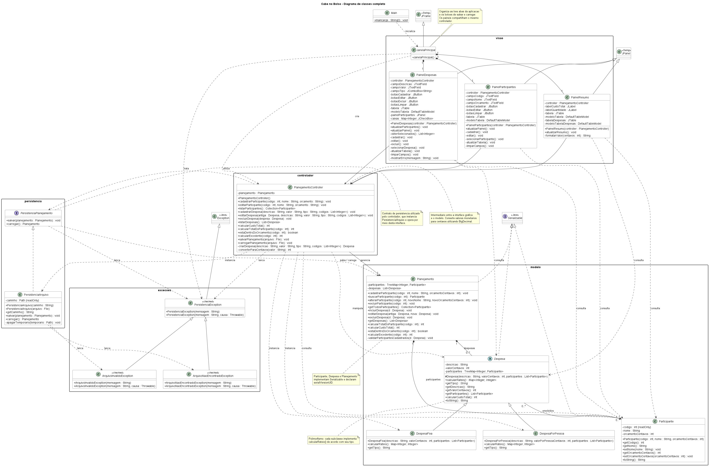

# Modelagem, arquitetura MVC, persistência e exceções

Projeto **Cabe no Bolso**: planejador de despesas compartilhadas.

Este documento explica o diagrama de classes, a arquitetura MVC, os conceitos de orientação a objetos, a persistência, o tratamento de exceções e os testes realizados no sistema.

## 1. Diagrama de classes



A imagem também está disponível em formato vetorial ([diagrama_classes.svg](diagrama_classes.svg)), que pode ser ampliado sem perder qualidade.

O arquivo [diagrama_classes.puml](diagrama_classes.puml) contém o código-fonte do diagrama em PlantUML.

O diagrama representa as classes principais dos pacotes modelo, controlador, visao, persistencia e excecoes, além da classe Main.

As imagens podem ser geradas pela extensão PlantUML do VS Code, utilizando o comando PlantUML: Export Current Diagram.

Visibilidades utilizadas:

- `+`: público.
- `-`: privado.
- `#`: protegido.

As classes abstratas e os métodos abstratos são identificados no diagrama. Os atributos serialVersionUID foram omitidos para facilitar a visualização.

## 2. Arquitetura MVC

O projeto utiliza a arquitetura Model-View-Controller (MVC), separando as regras de negócio, a interface gráfica e o controle das operações.

### Model (modelo)

Responsável pelos dados e pelas regras de negócio.

- `Participante`: representa uma pessoa cadastrada, com código, nome e orçamento.
- `Planejamento`: gerencia participantes, despesas e cálculos financeiros.
- `Despesa`: classe abstrata que representa as características comuns das despesas.
- `DespesaFixa`: realiza a divisão de um valor fixo entre os participantes envolvidos.
- `DespesaPorPessoa`: calcula despesas cujo valor é cobrado individualmente.

### View (visao)

Responsável pela interação com o usuário, utilizando Java Swing.

- `JanelaPrincipal`: organiza as abas e os botões de salvar e carregar.
- `PainelParticipantes`: permite cadastrar e editar participantes.
- `PainelDespesas`: permite cadastrar, editar e excluir despesas, selecionando os participantes envolvidos.
- `PainelResumo`: apresenta as despesas, o custo total, os totais individuais, a situação dos orçamentos e os excedentes.

A interface utiliza componentes como JFrame, JPanel, JTable, JButton, JTextField, JComboBox, JCheckBox, JTabbedPane, JFileChooser e JOptionPane.

### Controller (controlador)

A classe `PlanejamentoController` realiza a comunicação entre a interface gráfica e o modelo.

Suas responsabilidades incluem:

- Encaminhar operações de cadastro e edição de participantes.
- Encaminhar operações de cadastro, edição e exclusão de despesas.
- Instanciar o tipo adequado de despesa.
- Disponibilizar os resultados dos cálculos financeiros.
- Converter valores monetários para centavos utilizando BigDecimal.
- Salvar e carregar o planejamento por meio da persistência.

Os três painéis compartilham a mesma instância do controlador, garantindo que utilizem o mesmo planejamento.

### Inicialização

A classe `Main` é responsável por iniciar a aplicação e abrir a janela principal.

### Persistência e exceções

Os pacotes persistencia e excecoes complementam a arquitetura, permitindo armazenar o planejamento em arquivos locais e tratar falhas de leitura e gravação.

## 3. Justificativa das relações

| Relação | Multiplicidade | Tipo | Justificativa |
|---|---|---|---|
| Planejamento → Participante | 1 para 0..* | Composição | Os participantes pertencem ao planejamento e são armazenados em um TreeMap, com o código como chave. |
| Planejamento → Despesa | 1 para 0..* | Composição | As despesas pertencem ao planejamento e são armazenadas em uma List. |
| Despesa → Participante | 0..* para 1..* | Associação | Cada despesa referencia pelo menos um participante cadastrado. Excluir uma despesa não exclui os participantes. |
| DespesaFixa e DespesaPorPessoa → Despesa | - | Herança | As subclasses reutilizam características comuns e implementam suas próprias regras de rateio. |
| PersistenciaArquivo → PersistenciaPlanejamento | - | Realização | A classe implementa o contrato de salvar e carregar planejamentos. |
| PersistenciaPlanejamento → Planejamento | - | Dependência | A persistência recebe e devolve objetos Planejamento. |
| ArquivoNaoEncontradoException e ArquivoInvalidoException → PersistenciaException | - | Herança | Permite tratar falhas de persistência de forma geral ou específica. |
| PlanejamentoController → Planejamento | 1 para 1 | Associação | O controlador mantém uma referência ao planejamento em uso. |
| Painéis → PlanejamentoController | - | Associação | Os painéis compartilham o controlador para acessar as operações do sistema. |
| JanelaPrincipal → Painéis | 1 para 1 de cada tipo | Composição | A janela cria e organiza os três painéis da aplicação. |
| JanelaPrincipal → JFrame | - | Herança | A janela principal utiliza os recursos da classe JFrame. |
| Painéis → JPanel | - | Herança | Os painéis utilizam os recursos da classe JPanel. |
| PlanejamentoController → PersistenciaPlanejamento | - | Dependência | O controlador utiliza o contrato de persistência. |
| PlanejamentoController → PersistenciaArquivo | - | Dependência | O controlador instancia a implementação de persistência em arquivo. |
| Main → JanelaPrincipal | - | Dependência | A classe Main inicializa a interface gráfica. |

## 4. Conceitos de programação orientada a objetos

| Conceito | Aplicação no projeto |
|---|---|
| Encapsulamento | Atributos privados, métodos de acesso e validações. As coleções retornadas pelo planejamento não permitem modificações diretas. |
| Herança | DespesaFixa e DespesaPorPessoa estendem Despesa. As exceções específicas estendem PersistenciaException. A interface gráfica também utiliza herança de JFrame e JPanel. |
| Polimorfismo | O planejamento trabalha com referências do tipo Despesa e executa calcularRateio() conforme a implementação de cada subclasse. |
| Interface | PersistenciaPlanejamento define o contrato de persistência. Serializable permite a serialização dos objetos do modelo. |
| Abstração | Despesa representa as características comuns dos diferentes tipos de despesas e não pode ser instanciada diretamente. |
| Composição | O planejamento contém participantes e despesas. A janela principal contém os painéis da interface gráfica. |

## 5. Persistência

**Formato:** serialização de objetos utilizando ObjectOutputStream e ObjectInputStream.

Participante, Despesa e Planejamento implementam Serializable. As subclasses de Despesa também são serializáveis por herança.

### Preservação dos relacionamentos

O método writeObject grava o planejamento completo.

Quando o mesmo objeto aparece em diferentes partes da estrutura, a serialização preserva suas referências. Dessa forma, os participantes associados às despesas continuam sendo os mesmos objetos presentes no cadastro após o carregamento.

O TestePersistencia verifica essa preservação.

### Fechamento dos fluxos

As operações de leitura e gravação utilizam try-with-resources, garantindo o fechamento dos fluxos mesmo quando ocorre uma exceção.

### Segurança na gravação

Os dados são gravados inicialmente em um arquivo temporário e posteriormente transferidos para o arquivo definitivo utilizando Files.move.

Essa estratégia reduz o risco de perder um arquivo válido caso ocorra uma falha durante a gravação dos dados.

### Segurança no carregamento

O método carregar() retorna o planejamento recuperado do arquivo.

O controlador substitui o planejamento atual somente após o carregamento ser concluído com sucesso.

Caso ocorra uma exceção durante a leitura, o planejamento que estava em uso permanece preservado.

## 6. Tratamento de exceções

| Situação | Exceção |
|---|---|
| Arquivo inexistente | ArquivoNaoEncontradoException |
| Arquivo vazio ou incompleto | ArquivoInvalidoException |
| Arquivo corrompido ou de formato inválido | ArquivoInvalidoException |
| Arquivo de versão incompatível | ArquivoInvalidoException |
| Tentativa de salvar em uma pasta | PersistenciaException |
| Tentativa de carregar uma pasta | ArquivoInvalidoException |
| Erro de leitura ou gravação | PersistenciaException |
| Caminho vazio ou planejamento nulo | IllegalArgumentException |
| Dados inválidos de participantes ou despesas | IllegalArgumentException |

As exceções de persistência são verificadas (checked exceptions), permitindo que as falhas de arquivo sejam tratadas explicitamente.

As validações das regras de negócio utilizam IllegalArgumentException.

O controlador encaminha as operações e propaga as exceções para a interface gráfica, que apresenta mensagens ao usuário utilizando JOptionPane.

## 7. Integração da persistência com a interface gráfica

Ao iniciar o programa, o controlador cria um planejamento vazio.

O usuário pode cadastrar novos dados ou carregar um planejamento anteriormente salvo.

### Método de salvamento no controlador

```java
public void salvarPlanejamento(File arquivo)
        throws PersistenciaException {

    PersistenciaPlanejamento persistencia =
            new PersistenciaArquivo(arquivo);

    persistencia.salvar(planejamento);
}
```

### Método de carregamento no controlador

```java
public void carregarPlanejamento(File arquivo)
        throws PersistenciaException {

    PersistenciaPlanejamento persistencia =
            new PersistenciaArquivo(arquivo);

    Planejamento carregado = persistencia.carregar();

    planejamento = carregado;
}
```

### Botão Salvar planejamento

1. Abre um seletor de arquivos com JFileChooser.
2. Permite escolher o local e o nome do arquivo.
3. Acrescenta a extensão .dat quando necessário.
4. Solicita confirmação caso o arquivo já exista.
5. Solicita ao controlador o salvamento.
6. Apresenta uma mensagem de sucesso ou erro.

### Botão Carregar planejamento

1. Abre um seletor de arquivos com JFileChooser.
2. Permite selecionar um planejamento salvo.
3. Solicita confirmação antes de substituir o planejamento atual.
4. Solicita ao controlador o carregamento.
5. Atualiza os painéis de participantes, despesas e resumo.
6. Apresenta uma mensagem de sucesso ou erro.

Se o carregamento falhar, o planejamento anterior permanece em uso.

## 8. Representação monetária e rateio

Os valores monetários são armazenados como números inteiros em centavos, evitando imprecisões nos cálculos financeiros com ponto flutuante.

O controlador utiliza BigDecimal para converter os valores digitados pelo usuário.

Nas despesas fixas, quando a divisão não é exata, os centavos restantes são distribuídos seguindo a ordem crescente dos códigos dos participantes.

Nas despesas por pessoa, cada participante envolvido recebe o valor individual informado.

O resumo financeiro apresenta o custo total do planejamento, os totais individuais, os orçamentos e os valores excedentes.

Um participante cujo total de despesas é igual ao orçamento é considerado dentro do orçamento.

## 9. Testes da persistência

Os testes automatizados podem ser executados com:

```bash
java persistencia.TestePersistencia
```

Cenários verificados:

| Cenário | Verificação |
|---|---|
| Salvar e carregar | Participantes, despesas, tipos, valores e relacionamentos preservados. |
| Alteração de orçamento | Atualização da situação financeira após a alteração. |
| Exclusão de despesa | Recálculo dos valores e preservação após salvar e carregar. |
| Sobrescrita de arquivo | Atualização dos dados armazenados. |
| Planejamento vazio | Salvamento e carregamento sem participantes ou despesas. |
| Arquivos inválidos | Tratamento das exceções e preservação do planejamento em uso. |

Resultado observado na execução: **50 verificações e 0 falhas**.

O arquivo de exemplo `dados/caso_referencia.dat` é gerado pela classe `persistencia.GeradorArquivoExemplo`.

## 10. Testes da interface gráfica

Foram realizados testes manuais utilizando a aplicação Swing.

| Funcionalidade | Resultado observado |
|---|---|
| Cadastro de participantes | Aprovado |
| Edição de participantes | Aprovado |
| Cadastro de despesa fixa | Aprovado |
| Cadastro de despesa por pessoa | Aprovado |
| Edição de despesas | Aprovado |
| Exclusão de despesas | Aprovado |
| Rejeição de despesas inválidas | Aprovado |
| Resumo financeiro | Aprovado |
| Rateio com arredondamento de centavos | Aprovado |
| Salvamento pela interface gráfica | Aprovado |
| Carregamento pela interface gráfica | Aprovado |
| Carregamento de arquivo inválido | Aprovado |
| Preservação dos dados após falha de carregamento | Aprovado |

### Caso de referência do enunciado

| Participante | Orçamento | Total individual | Excedente |
|---|---:|---:|---:|
| Ana | R$ 70,00 | R$ 75,00 | R$ 5,00 |
| Bruno | R$ 60,00 | R$ 60,00 | R$ 0,00 |
| Carla | R$ 70,00 | R$ 75,00 | R$ 5,00 |

**Custo total do planejamento: R$ 210,00.**

Os resultados obtidos na interface gráfica corresponderam aos valores esperados no caso de referência.

### Teste de arredondamento

Foi adicionada ao caso de referência uma despesa fixa de R$ 100,00 envolvendo os três participantes.

O rateio dessa despesa resultou em:

- Ana: R$ 33,34.
- Bruno: R$ 33,33.
- Carla: R$ 33,33.

A soma dos valores corresponde exatamente a R$ 100,00, respeitando a distribuição dos centavos restantes pela ordem crescente dos códigos.

O custo total do planejamento durante esse teste foi de R$ 310,00.
