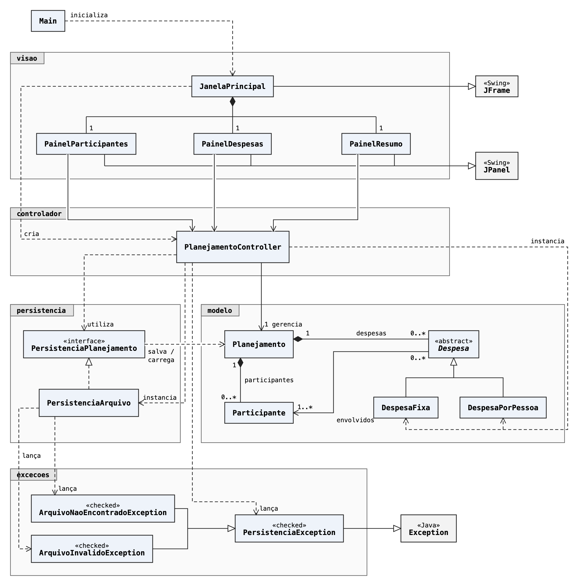
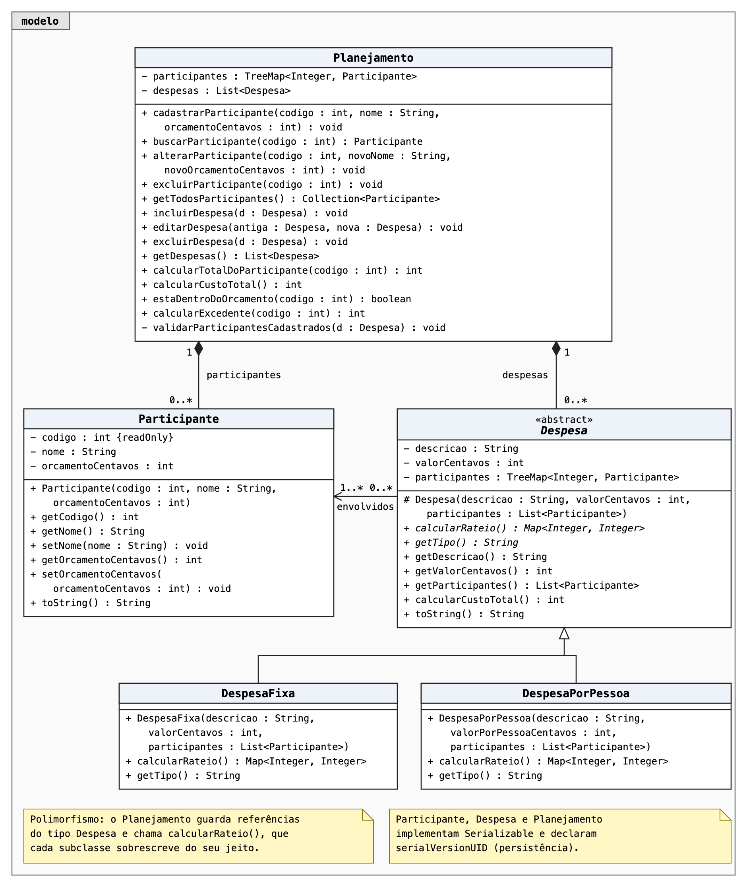
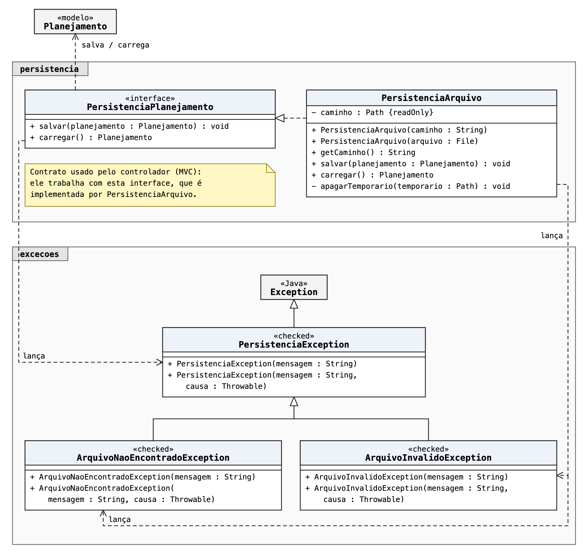
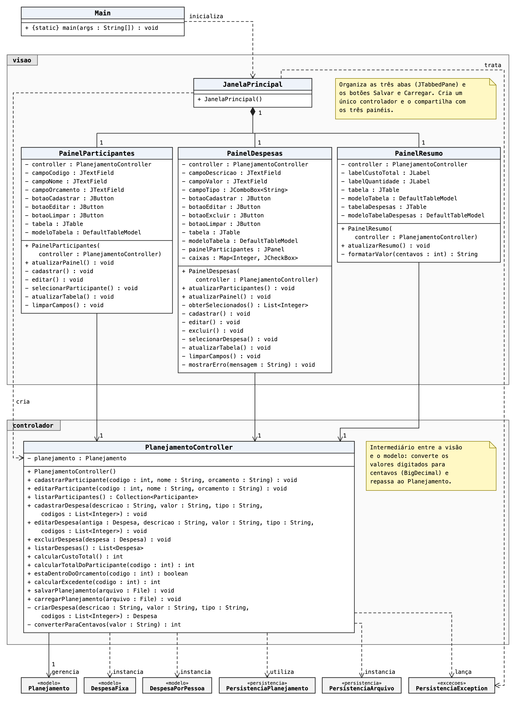

# Modelagem, persistência e exceções

Projeto **Cabe no Bolso**: planejador de despesas compartilhadas.
Este documento explica o diagrama de classes e as decisões da parte de **persistência, exceções e UML**.

## 1. Diagrama de classes

O sistema tem 18 classes. Com todos os atributos e operações num desenho só, a imagem fica pequena demais para ler em uma página. Por isso o diagrama foi dividido em quatro figuras, cada uma feita para caber na largura da página:

| Figura | Arquivo | Conteúdo |
|---|---|---|
| Visão geral | [`uml_1_visao_geral.png`](uml_1_visao_geral.png) | Todas as classes (só os nomes), pacotes MVC e todas as relações. |
| Modelo | [`uml_2_modelo.png`](uml_2_modelo.png) | Atributos, operações e multiplicidades do pacote `modelo`. |
| Persistência e exceções | [`uml_3_persistencia_excecoes.png`](uml_3_persistencia_excecoes.png) | Interface de persistência, classe de arquivo e hierarquia de exceções. |
| Visão e controlador | [`uml_4_visao_controlador.png`](uml_4_visao_controlador.png) | `Main`, janela, painéis Swing e `PlanejamentoController`. |






Cada figura também está em vetor (`.svg`), que pode ser ampliado sem perder qualidade. O arquivo [`diagrama_classes.puml`](diagrama_classes.puml) é o diagrama completo em PlantUML, num arquivo só, para quem quiser editar ou conferir.

Visibilidades usadas: `+` público, `-` privado, `#` protegido. Nome em itálico indica classe ou método abstrato. Todas as classes do modelo também têm `serialVersionUID` (omitido do desenho para não poluir).

## 2. Justificativa das relações

| Relação | Multiplicidade | Tipo | Por quê |
|---|---|---|---|
| `Planejamento` → `Participante` | 1 para 0..* | Composição | Os participantes cadastrados fazem parte do planejamento: sem planejamento não existe cadastro. Ficam em um `TreeMap` com o código como chave, o que impede código duplicado e mantém a ordem crescente de código. |
| `Planejamento` → `Despesa` | 1 para 0..* | Composição | As despesas pertencem ao planejamento e são guardadas em uma `List`, que mantém a ordem de inclusão. |
| `Despesa` → `Participante` | 0..* para 1..* | Associação | Uma despesa precisa de pelo menos um participante (regra do enunciado), mas ela só **referencia** quem já está cadastrado. Excluir a despesa não exclui a pessoa. |
| `Despesa` ◁ `DespesaFixa` e `DespesaPorPessoa` | - | Herança | A superclasse abstrata guarda o que é comum (descrição, valor, participantes e validações). Cada subclasse sobrescreve `calcularRateio()` com a sua regra. |
| `PersistenciaArquivo` ▷ `PersistenciaPlanejamento` | - | Realização | A interface define o contrato (`salvar` e `carregar`) e a classe de arquivo o cumpre. O controlador usa só a interface. |
| `PersistenciaPlanejamento` ⇢ `Planejamento` | - | Dependência | A persistência recebe e devolve planejamentos, mas não guarda nenhum como atributo. |
| `PersistenciaException` ◁ `ArquivoNaoEncontradoException` e `ArquivoInvalidoException` | - | Herança | Permite tratar toda falha de arquivo de uma vez (superclasse) ou cada caso separadamente (subclasses). |
| `JanelaPrincipal` → `PainelParticipantes`, `PainelDespesas` e `PainelResumo` | 1 para 1 (cada) | Composição | A janela cria os três painéis e os coloca nas abas: eles só existem dentro dela. |
| Painéis → `PlanejamentoController` | 1 | Associação | Cada painel guarda o mesmo controlador e encaminha a ele as ações do usuário (MVC). |
| `PlanejamentoController` → `Planejamento` | 1 | Associação | O controlador guarda o planejamento em uso e o troca ao carregar um arquivo. |
| `PlanejamentoController` ⇢ `PersistenciaPlanejamento` | - | Dependência | Salva e carrega pela interface, criando um `PersistenciaArquivo` a partir do arquivo escolhido. |
| `JFrame` ◁ `JanelaPrincipal` e `JPanel` ◁ painéis | - | Herança | As telas são componentes Swing. |

## 3. Onde aparece cada conceito de POO

| Conceito | Onde |
|---|---|
| Encapsulamento | Atributos `private` em todas as classes, com acesso por getters e setters validados. `Planejamento.getDespesas()` e `getTodosParticipantes()` devolvem coleções não modificáveis. `PersistenciaArquivo` guarda o `caminho` como `private final`. |
| Herança | `DespesaFixa` e `DespesaPorPessoa` estendem `Despesa`. As exceções de persistência estendem `PersistenciaException`. |
| Polimorfismo | `Planejamento` guarda `Despesa` e chama `calcularRateio()`, e o Java escolhe a versão da subclasse. Ao carregar do arquivo, cada despesa volta com a sua classe original (`DespesaFixa` ou `DespesaPorPessoa`). |
| Interface | `PersistenciaPlanejamento` (contrato de persistência) e `Serializable` (modelo). |
| Abstração | `Despesa` é abstrata e não pode ser instanciada. |

## 4. Persistência

**Formato:** serialização de objetos (`ObjectOutputStream` e `ObjectInputStream`), como pede o enunciado. Todas as classes do modelo implementam `Serializable` e declaram `serialVersionUID`.

**Planejamento completo em uma só gravação.** O `writeObject` é chamado uma única vez com o `Planejamento` inteiro. Se o mesmo objeto aparece em dois lugares, o Java o grava uma vez e guarda referências. Por isso o `Participante` do cadastro e o `Participante` dentro de cada `Despesa` continuam sendo o **mesmo objeto** depois de carregar. Essa é a forma de preservar as relações entre participantes e despesas sem duplicar registros (o `TestePersistencia` confere esse ponto).

**Fluxos fechados.** Salvar e carregar usam `try-with-resources`, que fecha os fluxos mesmo quando ocorre erro.

**Salvar com segurança.** Os dados são gravados primeiro em `<arquivo>.tmp` e só depois trocam o arquivo definitivo (`Files.move`). Se a gravação falhar no meio (disco cheio, sem permissão), o arquivo salvo antes continua intacto. O temporário é apagado em qualquer caso.

**Carregar sem risco.** `carregar()` devolve um `Planejamento` novo e nunca mexe no que está em uso. Se qualquer coisa falhar, a exceção é lançada antes de devolver algo, então uma falha ao carregar **preserva o planejamento em uso**.

## 5. Exceções

| Situação | Exceção | Mensagem (resumo) |
|---|---|---|
| Arquivo não existe | `ArquivoNaoEncontradoException` | "Arquivo não encontrado: ..." |
| Arquivo vazio ou cortado | `ArquivoInvalidoException` | "... está vazio ou incompleto." |
| Arquivo que não é planejamento (texto, imagem, outro objeto) | `ArquivoInvalidoException` | "... não é um arquivo de planejamento válido ou está corrompido." |
| Arquivo de outra versão das classes | `ArquivoInvalidoException` | "... foi gerado por uma versão incompatível do programa." |
| Caminho é uma pasta | `PersistenciaException` ao salvar, `ArquivoInvalidoException` ao carregar | "... é uma pasta, não um arquivo." |
| Sem permissão, disco cheio, erro de E/S | `PersistenciaException` | "Não foi possível salvar/ler ..." |
| Caminho vazio ou planejamento nulo | `IllegalArgumentException` | "Informe o caminho do arquivo!" / "Não há planejamento para salvar!" |

As três exceções de arquivo são **verificadas** (`extends Exception`): o compilador obriga a interface a tratar a falha, que pode acontecer mesmo com o programa correto. A exceção técnica original fica em `getCause()`.

As **validações do modelo** (código duplicado, valor negativo, despesa sem participantes, campo vazio) continuam sendo `IllegalArgumentException` com mensagem clara, como nas partes A e B. O controlador deve tratar os dois tipos: `IllegalArgumentException` (regra violada) e `PersistenciaException` (falha de arquivo).

## 6. Como o controlador deve usar a persistência

```java
PersistenciaPlanejamento persistencia = new PersistenciaArquivo("dados/planejamento.dat");

// Ao abrir o programa: sem arquivo salvo, começa vazio
Planejamento planejamento;
try {
    planejamento = persistencia.carregar();
} catch (ArquivoNaoEncontradoException e) {
    planejamento = new Planejamento();
} catch (PersistenciaException e) {
    JOptionPane.showMessageDialog(null, e.getMessage(), "Erro", JOptionPane.ERROR_MESSAGE);
    planejamento = new Planejamento();
}

// Botão Salvar
try {
    persistencia.salvar(planejamento);
} catch (PersistenciaException e) {
    JOptionPane.showMessageDialog(null, e.getMessage(), "Erro", JOptionPane.ERROR_MESSAGE);
}

// Botão Carregar: só troca o planejamento em uso se carregar() der certo
try {
    planejamento = persistencia.carregar();
    // atualizar as tabelas da interface
} catch (PersistenciaException e) {
    JOptionPane.showMessageDialog(null, e.getMessage(), "Erro", JOptionPane.ERROR_MESSAGE);
    // o planejamento antigo continua valendo
}
```

## 7. Testes da persistência

Execute `persistencia.TestePersistencia` (instruções no README do projeto). Ele cobre:

| Cenário do enunciado | Verificação |
|---|---|
| Salvar e reiniciar | Caso de referência salvo e recuperado: participantes, despesas, tipos, totais, excedentes e vínculos iguais, sem duplicar registros. |
| Alteração de orçamento | Depois de carregar, o orçamento da Ana a R$ 80,00 deixa o total de R$ 75,00 dentro do limite. |
| Exclusão de despesa | Excluir a atividade recreativa, salvar e carregar resulta em R$ 60,00 por pessoa e R$ 180,00 no total. |
| Problema no arquivo | Arquivo ausente, vazio, cortado, de texto, de outro tipo e pasta: mensagem clara e planejamento em uso preservado. |

O arquivo de exemplo `dados/caso_referencia.dat` é gerado por `persistencia.GeradorArquivoExemplo`.
